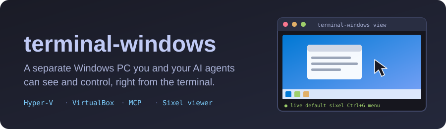
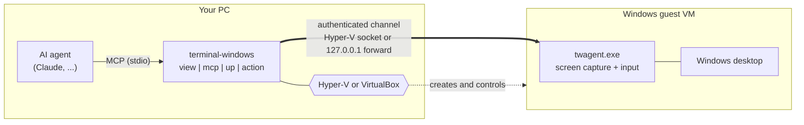
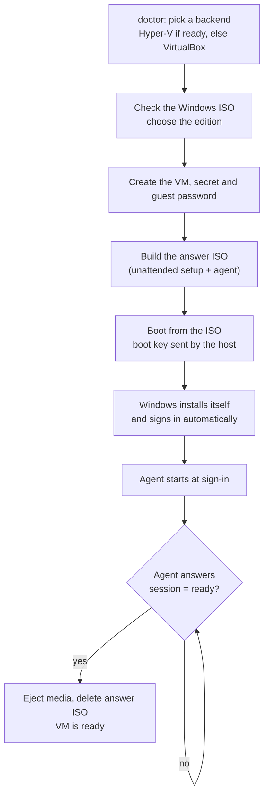
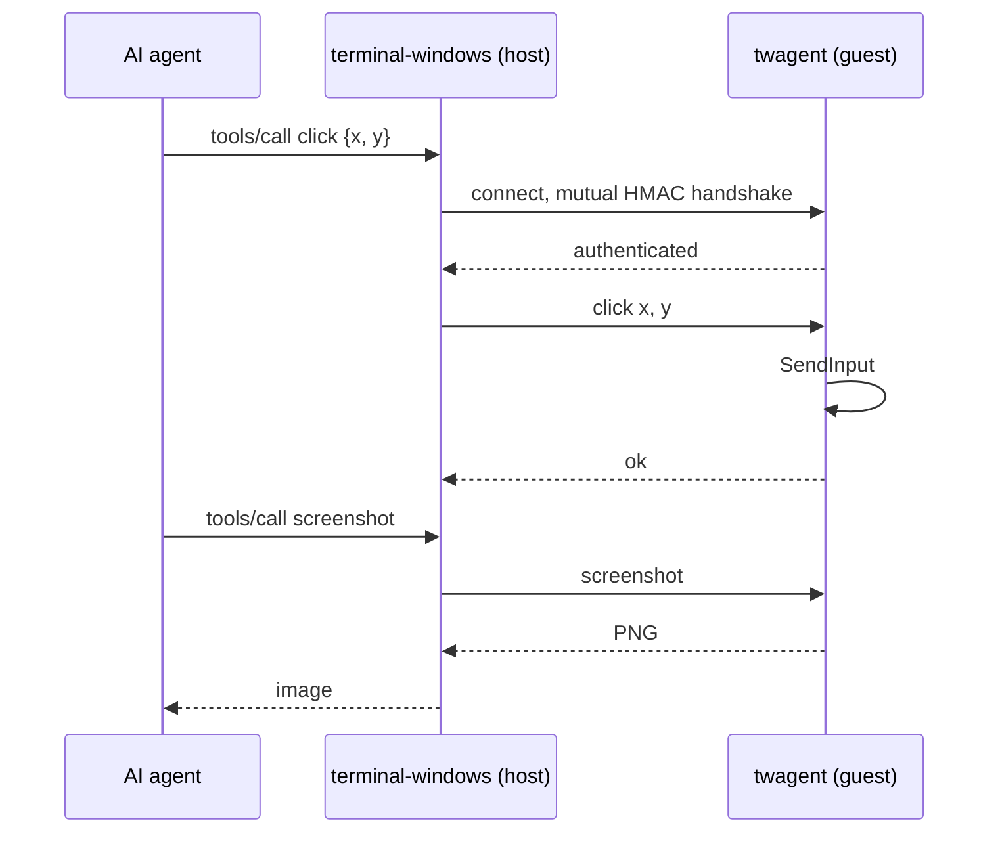

<p align="center"></p>

<p align="center">
  <a href="https://github.com/Aneesh-Madupalli/terminal-windows/actions/workflows/ci.yml"></a>
  <a href="LICENSE"></a>
  
  
  
</p>

# terminal-windows

A real Windows PC in a virtual machine (Hyper-V or VirtualBox) that you, and your AI agents, can see and control from a terminal. Everything happens inside the VM; your own desktop is never touched.

- `terminal-windows up --iso PATH` installs Windows unattended and gets it ready.
- `terminal-windows view` shows the guest desktop in your terminal (Sixel in Windows Terminal, half blocks anywhere) and forwards keyboard and mouse.
- `terminal-windows mcp` serves the guest to an AI agent over MCP: `screenshot`, `click`, `move`, `drag`, `scroll`, `type`, `key`, `status`.
- No shell-execution action exists. The channel between host and guest is a Hyper-V socket, mutually authenticated with a per-VM secret.

## How it fits together



## What `up` does



## A request, step by step



## Requirements

- Windows 10/11 **Pro, Enterprise or Education** with Hyper-V, **or any Windows edition (including Home) with [VirtualBox 7](https://www.virtualbox.org)**. `terminal-windows up` uses Hyper-V when it is ready and VirtualBox otherwise; force one with `--backend hyperv|virtualbox`.
- Hardware virtualization on, 8 GiB or more of RAM, 64 GiB of disk.
- A Windows 10 22H2 or Windows 11 x64 ISO.

## Install

```powershell
.\scripts\build.ps1            # builds dist\terminal-windows-<version>-x64.zip
.\scripts\install.ps1          # installs for the current user and adds it to PATH
terminal-windows doctor        # checks this PC
terminal-windows setup-host --enable-hyper-v   # once, from an elevated prompt, if doctor asks
terminal-windows up --iso C:\ISOs\Win11.iso --edition "Windows 11 Pro"
terminal-windows view
```

## Commands

Run `terminal-windows help`. The main ones: `doctor`, `setup-host`, `iso check`, `up`, `view`, `mcp`, `action`, `screenshot`, `logs`, `ls`, `status`, `start`, `stop`, `pause`, `resume`, `show`, `hide`, `checkpoint`, `credential show`, `agent update`, `rm`.

Exit codes: 0 success, 1 failure, 2 usage, 3 prerequisite missing, 4 no such VM, 5 VM not running, 6 guest not ready, 7 access denied, 8 guest locked.

## For AI agents

Add the MCP server to your client (the Claude plugin manifest is in `.claude-plugin`):

```json
{
  "mcpServers": {
    "terminal-windows": { "command": "terminal-windows", "args": ["mcp"] }
  }
}
```

`skills\terminal-windows\SKILL.md` teaches an agent how to drive the guest.

## Layout

| Crate                      | Purpose                                                                            |
| -------------------------- | ---------------------------------------------------------------------------------- |
| `tw-core`                  | Names, arguments, key table, machine records, secret storage                       |
| `tw-proto`, `tw-transport` | Wire protocol, authentication, framing, Hyper-V sockets                            |
| `tw-client`, `tw-mcp`      | Host client, frame stream, MCP server                                              |
| `tw-hv`                    | Hyper-V (PowerShell) and VirtualBox (`VBoxManage`) backends, plus a fake for tests |
| `tw-provision`             | ISO inspection, answer file, answer ISO, credentials                               |
| `tw-agent`                 | Guest agent (`twagent.exe`)                                                        |
| `tw-term`, `tw-viewer`     | Terminal graphics, input and the viewer                                            |
| `tw-cli`                   | The `terminal-windows` command                                                     |

Design documents: `docs\PRD.md`, `docs\TDD.md`, `docs\VALIDATION.md`.

## Status

Every crate is built and tested without a hypervisor (about 320 tests, including real PowerShell, DPAPI, ISO building and mounting, and screen capture on the build machine). The Hyper-V and VirtualBox backends, the guest agent's input injection and the unattended install have not yet run against a real hypervisor (the VirtualBox backend is tested against a simulator of `VBoxManage`); `docs\VALIDATION.md` lists the checks to run there first.

## Development

```bash
cargo fmt && cargo clippy --workspace --all-targets -- -D warnings && cargo test --workspace
```

MIT licensed. Third-party notices: `THIRD-PARTY-NOTICES.md`.
