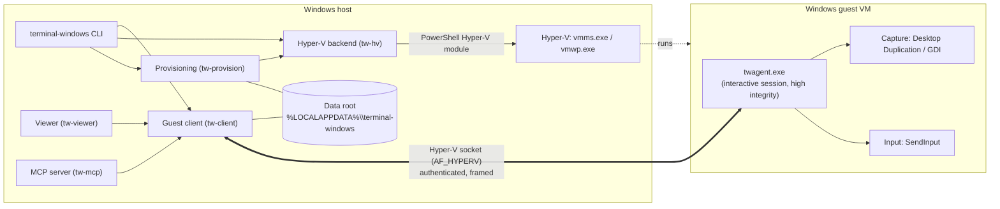
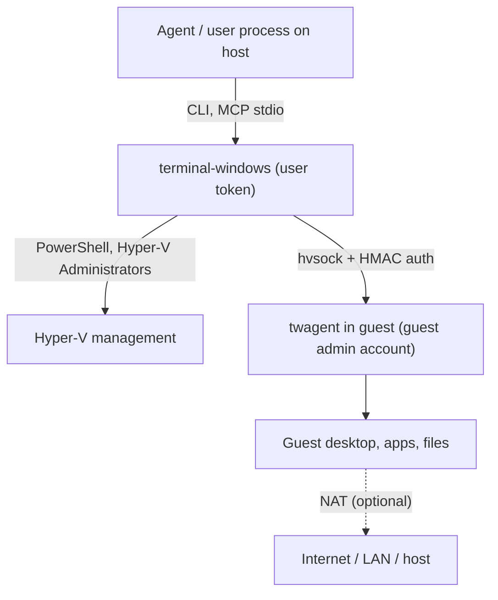
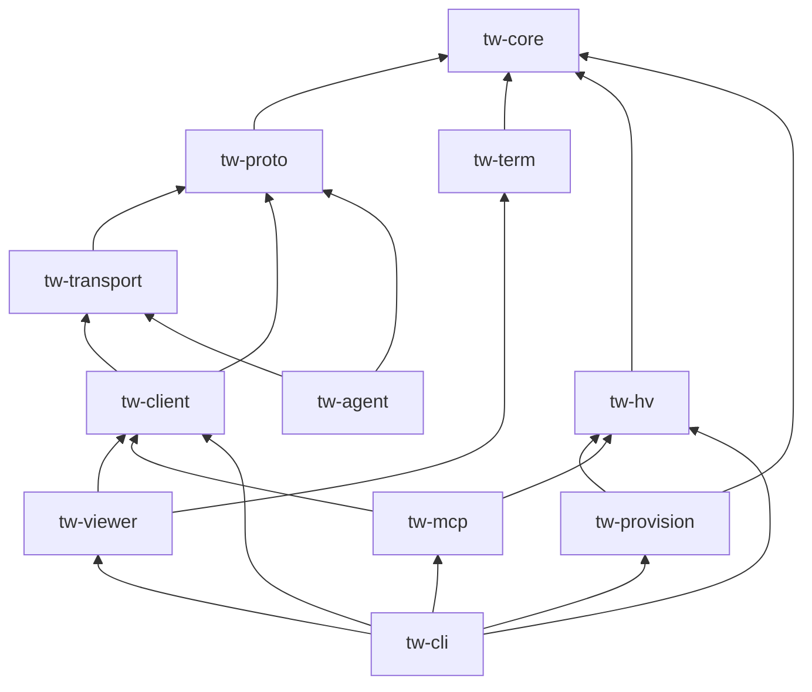
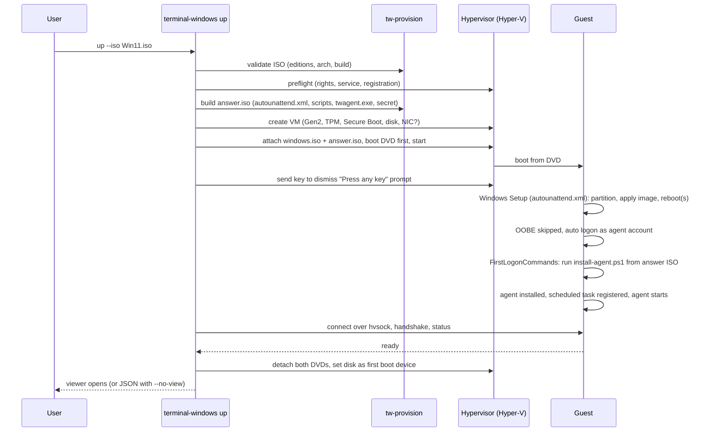
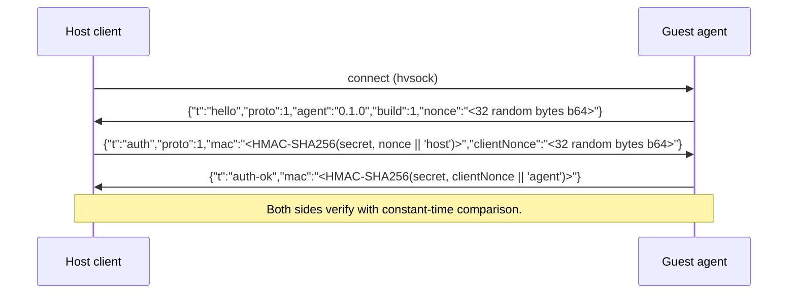
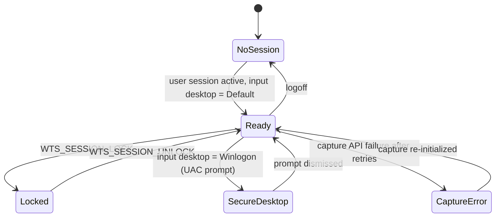
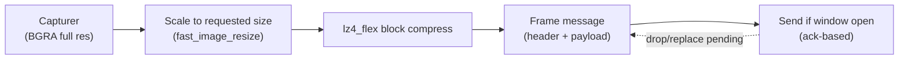
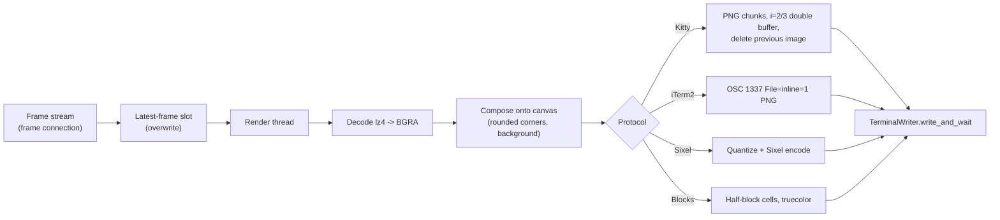
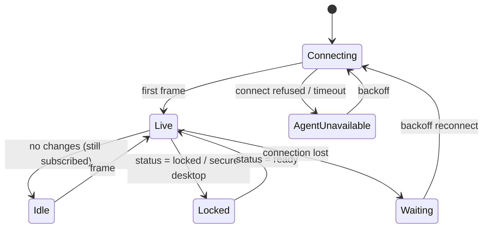

# terminal-windows — Technical Design Document (TDD)

| Field                            | Value                                |
| -------------------------------- | ------------------------------------ |
| Product                          | `terminal-windows`                   |
| Document                         | Technical Design Document            |
| Status                           | Draft 1 (for review)                 |
| Date                             | 2026-11-06                           |
| Companion document               | [PRD.md](PRD.md)                     |
| Reference implementation studied | [`terminal-mac`](../../terminal-mac) |
| Language                         | Rust (stable, edition 2024)          |

> **How to read this document.** Statements about Windows, Hyper-V and terminal behaviour that cannot be verified from the reference repository are marked **[VERIFY: Sn]**. Each maps to a Phase 0 spike in [section 19](#19-risks-and-phase-0-validation-spikes) that must be run on a real Hyper-V host before the dependent code is written. The design includes a fallback for every such item.

---

## Table of contents

1. [Introduction](#1-introduction)
2. [Architecture overview](#2-architecture-overview)
3. [Workspace and crates](#3-workspace-and-crates)
4. [Data model and on-disk layout](#4-data-model-and-on-disk-layout)
5. [Hypervisor abstraction and the Hyper-V backend](#5-hypervisor-abstraction-and-the-hyper-v-backend)
6. [Provisioning: ISO to ready desktop](#6-provisioning-iso-to-ready-desktop)
7. [Control transport: Hyper-V sockets](#7-control-transport-hyper-v-sockets)
8. [Wire protocol](#8-wire-protocol)
9. [Guest agent](#9-guest-agent)
10. [Host runtime](#10-host-runtime)
11. [Terminal viewer](#11-terminal-viewer)
12. [MCP server](#12-mcp-server)
13. [CLI specification](#13-cli-specification)
14. [Security design](#14-security-design)
15. [Errors, logging and diagnostics](#15-errors-logging-and-diagnostics)
16. [Performance design](#16-performance-design)
17. [Testing strategy](#17-testing-strategy)
18. [Build, packaging, signing and CI](#18-build-packaging-signing-and-ci)
19. [Risks and Phase 0 validation spikes](#19-risks-and-phase-0-validation-spikes)
20. [Work breakdown](#20-work-breakdown)
21. [Appendices](#21-appendices)

---

## 1. Introduction

### 1.1 Purpose

This document specifies how `terminal-windows` is built: processes, crates, data formats, protocols, algorithms, platform APIs, failure handling, security and tests. It satisfies the requirements in [PRD.md](PRD.md). Requirement IDs (`FR-...`, `NFR-...`) are referenced where useful.

### 1.2 Design principles

1. **The hypervisor owns the VM.** No tool process holds a VM alive. `terminal-mac` needs a detached `__run` process because Apple's `VZVirtualMachine` lives inside the process that starts it. Hyper-V runs VMs in its own service (`vmms.exe`, with `vmwp.exe` worker processes), so the CLI, viewer and MCP server are all stateless clients. A crashed tool cannot stop a VM.
2. **Hot paths avoid PowerShell.** Lifecycle operations (rare, slow) call Hyper-V management. Everything an agent does repeatedly (screenshot, click, type) goes over a Hyper-V socket straight to the guest agent.
3. **OS-independent core.** Protocol, models, parsing, layout, key tables and coordinate math live in crates with no Windows dependency, so they are unit-tested anywhere.
4. **Fixed actions, bounded input.** No "run a command" action. Every message is size-limited and strictly decoded.
5. **Parity first, then improvements.** Same CLI verbs, MCP tools and viewer behaviour as `terminal-mac`; improvements (unattended setup, push frames, checkpoints) are additive.
6. **Every uncertain Windows behaviour has a spike and a fallback.**

### 1.3 Mapping from `terminal-mac` components

| `terminal-mac`                                                                         | `terminal-windows`                                                                      |
| -------------------------------------------------------------------------------------- | --------------------------------------------------------------------------------------- |
| `Entry.swift`, `CLI.swift`                                                             | `tw-cli` crate: `main`, command dispatch, argument parsing (parsing logic in `tw-core`) |
| `Models.swift` (`Machine`, `Request`, `Reply`, `Store`, `Arguments`)                   | `tw-core` (`machine`, `args`, `store`) and `tw-proto` (`Request`, `Reply`)              |
| `Mailbox.swift`                                                                        | `tw-proto` framing plus `tw-transport` (Hyper-V socket client and server)               |
| `VirtualMachine.swift` (`VirtualMachines`, `MachineRuntime`)                           | `tw-hv` (`Hypervisor` trait, Hyper-V backend). No long-lived runtime process            |
| `Guest.swift`, `GuestCapture.swift`, `GuestBootstrap.swift`                            | `tw-agent` crate (`twagent.exe`) plus provisioning in `tw-provision`                    |
| `FirstRun.swift` (`up`)                                                                | `tw-cli::up` orchestrating `tw-provision`, `tw-hv`, `tw-client`                         |
| `RestoreDownload.swift`                                                                | Not applicable (no download). `tw-provision::iso` validates user ISOs                   |
| `Viewer.swift`, `DesktopRenderer.swift`                                                | `tw-viewer` crate                                                                       |
| `TerminalInput.swift`, `TerminalMetrics.swift`, `TerminalWriter.swift`, `Chrome.swift` | `tw-term` crate                                                                         |
| `AgentServer.swift`                                                                    | `tw-mcp` crate                                                                          |
| `Setup.swift` (`FileLock`, `GuestReadiness`, `SetupPlan`)                              | `tw-core::{lock, readiness, plan}`                                                      |
| `skills/terminal-mac/SKILL.md`                                                         | `skills/terminal-windows/SKILL.md`                                                      |
| `scripts/*.sh`, `packaging/get.sh`                                                     | `scripts/*.ps1`, `packaging/get.ps1`, GitHub Actions                                    |

## 2. Architecture overview

### 2.1 Component diagram



### 2.2 Process model

| Process                                   | Where          | Lifetime                                                          | Holds VM state?           |
| ----------------------------------------- | -------------- | ----------------------------------------------------------------- | ------------------------- |
| `terminal-windows.exe` (CLI, viewer, MCP) | Host           | Per invocation (MCP server: as long as the agent client keeps it) | No                        |
| `vmms.exe`, `vmwp.exe`                    | Host (Windows) | Managed by Windows                                                | Yes (Hyper-V owns the VM) |
| `twagent.exe`                             | Guest          | From user logon to logoff                                         | Guest-local only          |

There is no equivalent of `terminal-mac`'s detached `__run` process and no `runtime.lock` held for the VM's lifetime. Liveness is determined by Hyper-V (`Get-VM`) and, quickly, by whether the Hyper-V socket connects.

### 2.3 Trust boundaries



- The guest is untrusted from the host's point of view: the host never executes guest-provided content and bounds every received message.
- Local host processes of other users are not trusted: they are kept out by the per-VM secret and by ACLs on the data directory.

### 2.4 Key design decisions

| ID    | Decision                                                                                                      | Alternatives considered                                            | Rationale                                                                                                                                               |
| ----- | ------------------------------------------------------------------------------------------------------------- | ------------------------------------------------------------------ | ------------------------------------------------------------------------------------------------------------------------------------------------------- |
| ADR-1 | Hyper-V Generation 2 as the v1 hypervisor, behind a `Hypervisor` trait                                        | QEMU + WHPX first; custom VMM on WHP                               | Supported management surface, vTPM for Windows 11, Hyper-V sockets, cheap checkpoints. Not available on Home, so QEMU + WHPX follows in M6.             |
| ADR-2 | Hyper-V sockets for control                                                                                   | TCP over the NAT adapter; named pipes; a shared folder mailbox     | No network exposure, works with `--offline`, fast stream, no shared-folder permission surface.                                                          |
| ADR-3 | Guest agent in the interactive session via a scheduled task at logon with highest privileges, plus auto-logon | Windows service in session 0                                       | Session 0 isolation prevents capture and input in the user's desktop. A SYSTEM service with a session helper is the v2 path for secure-desktop support. |
| ADR-4 | Push-based frame stream with ack-based backpressure                                                           | Request and reply long polling (as in `terminal-mac`)              | Lower latency, no per-frame request overhead, natural on a stream socket. Request and reply is kept for screenshots and actions.                        |
| ADR-5 | PowerShell Hyper-V module for lifecycle in v1                                                                 | Direct WMI (`root\virtualization\v2`); the Host Compute System API | Documented and stable cmdlets with the least code. The trait allows swapping to WMI later.                                                              |
| ADR-6 | Unattended install through an answer ISO and `autounattend.xml`                                               | Manual setup; a prebuilt VHDX                                      | Zero guest interaction without distributing Windows images.                                                                                             |
| ADR-7 | Authenticate the Hyper-V socket with a per-VM secret                                                          | Rely on hvsock being host-local                                    | Other local users or processes could otherwise connect.                                                                                                 |

## 3. Workspace and crates

### 3.1 Layout

```text
terminal-windows/
├─ Cargo.toml                    # workspace
├─ rust-toolchain.toml
├─ crates/
│  ├─ tw-core/                   # OS-independent: models, args, errors, store paths, key table, plan, readiness
│  ├─ tw-proto/                  # OS-independent: wire framing, request/reply, actions, validation, auth messages
│  ├─ tw-term/                   # mostly OS-independent: input parser, metric filter, spans, boxes, layout, renderers' encoders
│  ├─ tw-transport/              # Transport trait; hvsock (windows) and loopback TCP (tests)
│  ├─ tw-client/                 # host-side guest client: connect, handshake, request/reply, frame subscription
│  ├─ tw-hv/                     # Hypervisor trait; hyperv backend (windows); fake backend (tests)
│  ├─ tw-provision/              # ISO validation, answer media, unattended XML, tools payload, readiness
│  ├─ tw-viewer/                 # terminal viewer (console I/O on Windows, renderers, palette, chrome)
│  ├─ tw-mcp/                    # MCP server
│  ├─ tw-agent/                  # guest agent binary: twagent.exe
│  └─ tw-cli/                    # binary: terminal-windows.exe
├─ guest/
│  ├─ setup/                     # files placed on the answer ISO (autounattend.xml template, install-agent.ps1)
│  └─ twagent.manifest           # application manifest (DPI awareness, UI access not requested, supported OS)
├─ skills/terminal-windows/SKILL.md
├─ .claude-plugin/{plugin.json,marketplace.json}
├─ scripts/                      # build.ps1, release.ps1, install.ps1, test-package.ps1
├─ packaging/get.ps1
├─ docs/{PRD.md,TDD.md,VALIDATION.md}
└─ tests/                        # cross-crate integration tests using the fake hypervisor and loopback transport
```

### 3.2 Crate responsibilities and dependencies



`tw-core`, `tw-proto` and `tw-term` compile and test on any OS. `tw-transport`, `tw-hv`, `tw-agent` and the Windows-specific parts of `tw-viewer` use `#[cfg(windows)]` modules; non-Windows builds get stubs so the workspace can be checked on other systems.

### 3.3 External crates (planned)

Versions are chosen at scaffold time; the latest stable versions are used.

| Purpose                                                                                     | Crate                                                                                        |
| ------------------------------------------------------------------------------------------- | -------------------------------------------------------------------------------------------- |
| Windows APIs (Win32, COM, console, Winsock, DXGI, D3D11, GDI, registry, Credential Manager) | `windows` (and `windows-sys` where a thin binding is enough)                                 |
| Async runtime                                                                               | `tokio` (current-thread runtime in the CLI and viewer; threads for blocking console I/O)     |
| CLI                                                                                         | hand-written parser ported from `Arguments` (strict, duplicate and unknown option rejection) |
| Serialization                                                                               | `serde`, `serde_json`                                                                        |
| Errors                                                                                      | `thiserror` (libraries), `anyhow` (binaries)                                                 |
| Async traits                                                                                | `async-trait` (keeps `Hypervisor` and `Transport` object-safe)                               |
| Hashing (GDI change detection)                                                              | `xxhash-rust`                                                                                |
| Logging                                                                                     | `tracing`, `tracing-subscriber`, `tracing-appender`                                          |
| Compression                                                                                 | `lz4_flex`                                                                                   |
| Image encode and decode                                                                     | `png`, `jpeg-encoder`, `image` (decode and resize), `fast_image_resize` (scaling)            |
| Sixel                                                                                       | a small in-tree encoder, or an existing Sixel crate if it meets quality needs                |
| Color quantization (Sixel)                                                                  | `color_quant` (NeuQuant) or an in-tree fixed palette                                         |
| UUID and random                                                                             | `uuid`, `getrandom`                                                                          |
| Crypto                                                                                      | `hmac`, `sha2`, `subtle` (constant-time comparison), `zeroize`                               |
| FAT image (fallback answer media)                                                           | `fatfs` (only if the IMAPI2 route fails)                                                     |
| XML                                                                                         | in-tree templating with escaping (the answer file is a fixed template)                       |
| Tests                                                                                       | `tempfile`, `proptest`, `insta` (snapshots)                                                  |

## 4. Data model and on-disk layout

### 4.1 Data root

Default: `%LOCALAPPDATA%\terminal-windows`. Override: `TERMINAL_WINDOWS_HOME`. The directory is created with an ACL granting access only to the current user, SYSTEM and Administrators (inheritance removed); Hyper-V adds the per-VM identity to the disk and configuration files it creates, which is confirmed in spike S7 **[VERIFY: S7]**. The path must be absolute and local.

```text
<root>\
├─ config.json                 # optional user config (defaults for new VMs, preferred protocol)
├─ logs\terminal-windows.<date>.log
├─ cache\
│  └─ iso-info\<sha256-prefix>.json     # parsed ISO metadata cache (editions, build, arch)
├─ setup-<name>.lock           # held during create/install
└─ machines\<name>\
   ├─ machine.json
   ├─ hv\                      # Hyper-V VM configuration files (New-VM -Path)
   ├─ disk.vhdx                # dynamically expanding system disk
   ├─ answer.iso               # autounattend.xml + setup scripts + agent installer (read-only DVD)
   ├─ channel.secret           # DPAPI-protected per-VM channel secret
   ├─ guest-ready              # marker: agent has answered at least once
   └─ operation.lock           # held during start/stop/checkpoint mutation
```

Hyper-V automatically grants the VM's own identity access to its disks when attached through its cmdlets. A user-profile location is therefore valid. If a policy or encrypted folder prevents it, `doctor` reports it and `TERMINAL_WINDOWS_HOME` can point elsewhere.

### 4.2 `machine.json`

```json
{
  "schema": 1,
  "name": "default",
  "hvName": "tw-default",
  "vmId": "7f3c0d9e-6c3a-4e64-9f5a-0d3f2f3c9a11",
  "backend": "hyperv",
  "cpu": 4,
  "memoryGiB": 8,
  "diskGiB": 64,
  "width": 1280,
  "height": 800,
  "network": true,
  "installed": true,
  "guestOs": "windows",
  "guestVersion": "10.0.26100",
  "agent": { "version": "0.1.0", "build": 1 },
  "createdAt": "2026-11-06T10:15:30Z",
  "credentialTarget": "terminal-windows/default/agent"
}
```

Rules: unknown fields are preserved on rewrite; `vmId` is only a cache and is re-read from Hyper-V by name on every connect, because it changes if the VM is exported and re-imported; `schema` allows migrations; writes are atomic (write to a temp file in the same directory, then rename).

### 4.3 Core types (`tw-core`)

```rust
pub struct Machine { /* fields above */ }

pub struct Store { root: PathBuf }
impl Store {
    pub fn directory(&self, name: &str) -> Result<PathBuf>;     // validates name
    pub fn load(&self, name: &str) -> Result<Machine>;
    pub fn save(&self, machine: &Machine) -> Result<()>;       // atomic
    pub fn list(&self) -> Result<Vec<Machine>>;
}

pub fn validate_name(name: &str) -> Result<()>;               // ^[a-zA-Z0-9][a-zA-Z0-9_-]{0,47}$

pub struct Arguments { positionals: Vec<String>, options: BTreeMap<String,String>, flags: BTreeSet<String> }
impl Arguments {
    pub fn parse(input: &[String], flags: &[&str], options: &[&str]) -> Result<Self>;
    pub fn integer(&self, key: &str, default: i64, range: RangeInclusive<i64>) -> Result<i64>;
    pub fn machine_name(&self) -> Result<String>;
}

pub enum GuestReadiness { Unavailable, NoSession, Locked, SecureDesktop, CaptureError, Ready }

pub struct SetupPlan { name: String, steps: Vec<&'static str> }
```

`Arguments::parse` ports the Swift semantics exactly: `--` ends option parsing; unknown or duplicate options are errors; an option missing its value is an error; a value that starts with `--` is not accepted as a value.

## 5. Hypervisor abstraction and the Hyper-V backend

### 5.1 The `Hypervisor` trait

```rust
#[async_trait::async_trait]
pub trait Hypervisor: Send + Sync {
    fn id(&self) -> &'static str;                                   // "hyperv", later "qemu-whpx"

    async fn preflight(&self) -> Result<Preflight>;                // feature state, rights, registration

    async fn create(&self, spec: &VmSpec) -> Result<Created>;      // creates VM, disk, devices; does not start
    async fn attach_dvd(&self, vm: &VmHandle, iso: &Path) -> Result<()>;
    async fn set_boot_dvd(&self, vm: &VmHandle, iso: &Path) -> Result<()>;   // the drive holding `iso` boots first
    async fn detach_dvds(&self, vm: &VmHandle) -> Result<()>;               // removes every DVD drive

    async fn start(&self, vm: &VmHandle) -> Result<()>;
    async fn stop(&self, vm: &VmHandle, mode: StopMode) -> Result<()>;   // Graceful | Force
    async fn pause(&self, vm: &VmHandle) -> Result<()>;
    async fn resume(&self, vm: &VmHandle) -> Result<()>;
    async fn state(&self, vm: &VmHandle) -> Result<VmState>;

    async fn press_key(&self, vm: &VmHandle, key: HostKey) -> Result<()>;   // boot prompt, ctrl+alt+del
    async fn type_text(&self, vm: &VmHandle, text: &str) -> Result<()>;     // host-side typing at lock screen

    async fn checkpoint_create(&self, vm: &VmHandle, label: &str) -> Result<()>;
    async fn checkpoint_list(&self, vm: &VmHandle) -> Result<Vec<Checkpoint>>;
    async fn checkpoint_restore(&self, vm: &VmHandle, label: &str) -> Result<()>;
    async fn checkpoint_remove(&self, vm: &VmHandle, label: &str) -> Result<()>;

    async fn open_console(&self, vm: &VmHandle) -> Result<()>;               // vmconnect
    async fn close_console(&self, vm: &VmHandle) -> Result<()>;
    async fn remove(&self, vm: &VmHandle, delete_files: bool) -> Result<()>;
}

pub struct VmSpec {
    pub name: String, pub cpu: u32, pub memory_bytes: u64, pub disk_bytes: u64,
    pub width: u32, pub height: u32, pub network: NetworkMode, pub root: PathBuf,
}
pub enum NetworkMode { Nat, None }
pub enum VmState { Off, Starting, Running, Paused, Saved, Stopping, Unknown(String) }
```

A `FakeHypervisor` implementation backs integration tests (section 17).

### 5.2 Hyper-V backend: invocation mechanism

All management goes through `powershell.exe` (Windows PowerShell 5.1, present on every supported Windows) running **fixed script templates embedded in the binary**:

```text
powershell.exe -NoProfile -NonInteractive -ExecutionPolicy Bypass -EncodedCommand <base64 of script>
```

The script reads its parameters from **standard input as JSON**, never from string interpolation:

```powershell
$p = [Console]::In.ReadToEnd() | ConvertFrom-Json
$vm = Get-VM -Name $p.hvName -ErrorAction Stop
# ...
@{ ok = $true; state = "$($vm.State)"; id = "$($vm.Id)" } | ConvertTo-Json -Compress
```

Rules:

- VM names are validated with `validate_name` and prefixed with `tw-`. Paths are canonicalized and must be inside the data root (or an explicit user-provided ISO path, checked to be an existing file).
- Scripts use `$ErrorActionPreference = 'Stop'`, emit **one JSON object** on stdout, and errors as `{ ok:false, code, message }`. The Rust side parses only that JSON; stderr is logged.
- Each call has a timeout. A timeout kills the PowerShell process tree (a `Job Object` with kill-on-close) and returns a clear error.
- Command-line length: `-EncodedCommand` carries the script as base64 of UTF-16, about 2.7 times its source size, and a Windows command line is limited to roughly 32 000 characters. A script whose encoded form would exceed about 24 000 characters is written to a temporary file in the user-only data directory and run with `-File` instead; the file is deleted afterwards.
- Cost: starting PowerShell takes roughly a few hundred milliseconds. This is acceptable because lifecycle calls are rare and the agent hot path does not use it. The `state` check used by the viewer polls the Hyper-V socket first and falls back to `Get-VM` only when the socket is down.

### 5.3 Operation to cmdlet mapping

| Operation                       | Cmdlets (parameters abbreviated)                                                                                                                                             | Notes                                                                                                                   |
| ------------------------------- | ---------------------------------------------------------------------------------------------------------------------------------------------------------------------------- | ----------------------------------------------------------------------------------------------------------------------- |
| Preflight                       | `Get-WindowsOptionalFeature -Online -FeatureName Microsoft-Hyper-V-All`, `Get-Service vmms`, `(Get-CimInstance Win32_Processor).VirtualizationFirmwareEnabled`, `Get-VMHost` | Feature query needs elevation on some builds; otherwise use `Get-Service vmms` and `Get-VMHost` success as the signal.  |
| Create                          | `New-VM -Name tw-NAME -Generation 2 -MemoryStartupBytes N -NewVHDPath disk.vhdx -NewVHDSizeBytes N -Path hv\ -SwitchName "Default Switch"` (omit the switch for `--offline`) |                                                                                                                         |
| CPU                             | `Set-VMProcessor -VMName tw-NAME -Count N`                                                                                                                                   |                                                                                                                         |
| Memory                          | `Set-VMMemory -VMName tw-NAME -DynamicMemoryEnabled $false -StartupBytes N`                                                                                                  | Static memory gives predictable agent behaviour.                                                                        |
| Secure Boot                     | `Set-VMFirmware -VMName tw-NAME -EnableSecureBoot On -SecureBootTemplate MicrosoftWindows`                                                                                   | Required for Windows 11.                                                                                                |
| vTPM                            | `Set-VMKeyProtector -VMName tw-NAME -NewLocalKeyProtector` then `Enable-VMTPM -VMName tw-NAME`                                                                               | Required for Windows 11.                                                                                                |
| Install media                   | `Add-VMDvdDrive -VMName tw-NAME -Path windows.iso` (and a second `Add-VMDvdDrive` for `answer.iso`), `Set-VMFirmware -FirstBootDevice $windowsDvd`                           | Two virtual DVD drives. The first boot device is the Windows ISO drive, not the answer ISO.                             |
| Display                         | `Set-VMVideo -VMName tw-NAME -HorizontalResolution W -VerticalResolution H -ResolutionType Single` **[VERIFY: S2]**                                                          | Generation 2 support and the allowed values are validated in spike S2.                                                  |
| Automatic checkpoints           | `Set-VM -Name tw-NAME -AutomaticStopAction ShutDown -AutomaticCheckpointsEnabled $false -CheckpointType Standard`                                                            |                                                                                                                         |
| Start                           | `Start-VM -Name tw-NAME`                                                                                                                                                     |                                                                                                                         |
| Graceful stop                   | `Stop-VM -Name tw-NAME -Confirm:$false`                                                                                                                                      | Uses the Shutdown integration service. Falls back after a timeout (60 s by default) to a message, as in `terminal-mac`. |
| Force stop                      | `Stop-VM -Name tw-NAME -TurnOff -Force`                                                                                                                                      |                                                                                                                         |
| Pause                           | `Suspend-VM -Name tw-NAME`                                                                                                                                                   |                                                                                                                         |
| Resume                          | `Resume-VM -Name tw-NAME`                                                                                                                                                    |                                                                                                                         |
| State                           | `(Get-VM -Name tw-NAME).State`, `.Id`                                                                                                                                        |                                                                                                                         |
| Checkpoint                      | `Checkpoint-VM -Name tw-NAME -SnapshotName LABEL`; `Get-VMSnapshot`; `Restore-VMSnapshot -Confirm:$false`; `Remove-VMSnapshot`                                               | Label validated like a name.                                                                                            |
| Remove                          | `Remove-VM -Name tw-NAME -Force`, then delete files under the VM directory                                                                                                   | Only after confirmation.                                                                                                |
| Boot-prompt key and host typing | CIM class `Msvm_Keyboard` in `root\virtualization\v2` (`PressKey`, `ReleaseKey`, `TypeText`, `TypeCtrlAltDel`) **[VERIFY: S6]**                                              | Reached through `Get-CimInstance` and `Invoke-CimMethod` in a fixed script.                                             |
| Console window                  | `vmconnect.exe localhost tw-NAME` (process managed by the CLI)                                                                                                               |                                                                                                                         |

### 5.4 Host rights and one-time setup

Hyper-V management requires administrator rights or membership in the local **Hyper-V Administrators** group. `setup-host` (elevated) does the following, each step idempotent and reported:

1. Verifies the Hyper-V feature is present and the `vmms` service exists. It never enables the feature on its own; with `--enable-hyper-v` it runs `Enable-WindowsOptionalFeature -Online -FeatureName Microsoft-Hyper-V-All` and tells the user a restart is required.
2. Adds the invoking user to **Hyper-V Administrators**, resolved by its well-known SID `S-1-5-32-578` because the group name is translated on non-English Windows (`Add-LocalGroupMember -SID S-1-5-32-578 -Member <user>`). `doctor` checks membership by the same SID. A sign-out and sign-in is required for the new group to apply to the user's token.
3. Registers the control channel service ID (section 7.2) under `HKLM\SOFTWARE\Microsoft\Windows NT\CurrentVersion\Virtualization\GuestCommunicationServices\<GUID>` with an `ElementName` value.
4. Prints a summary and the next command.

`doctor` checks each of these and distinguishes "not elevated and not in group" (exit code 7) from "feature missing" (exit code 3).

### 5.5 Second backend design (QEMU with WHPX, M6)

Not built in v1, but the trait is shaped for it. Differences the design already accounts for:

| Concern                   | Hyper-V         | QEMU + WHPX                                                                                                                                          |
| ------------------------- | --------------- | ---------------------------------------------------------------------------------------------------------------------------------------------------- |
| VM process                | Hyper-V service | A `qemu-system-x86_64.exe` process started by `tw-hv` and tracked through a PID file; unlike Hyper-V, the tool must keep it alive (it runs detached) |
| Control channel           | Hyper-V sockets | A virtio-serial or virtio-vsock channel exposed to the host as a named pipe or loopback socket, plus the QEMU monitor (QMP)                          |
| Screen and input fallback | `Msvm_Keyboard` | QMP `input-send-event` and `screendump`, which can also work without any guest agent                                                                 |
| TPM and Secure Boot       | Built in        | Requires a software TPM and OVMF firmware; Windows 10 is easier than Windows 11                                                                      |
| Home edition              | Not available   | Works with the Windows Hypervisor Platform feature enabled                                                                                           |
| Checkpoints               | Checkpoints     | qcow2 internal snapshots (`savevm`)                                                                                                                  |

The `Transport` trait (section 7) abstracts the channel so the client, viewer and MCP code do not change.

## 6. Provisioning: ISO to ready desktop

### 6.1 Overview



**Boot-prompt timing.** The "Press any key to boot from CD or DVD" prompt appears on every boot that reaches the DVD, including the reboots Windows Setup performs while installing. The tool therefore sends the key (for example Space) once per second **only during the first 30 seconds after the initial `Start-VM`**, and never again. Later reboots must fall through to the system disk, otherwise Setup would restart from the DVD in a loop.

### 6.2 ISO validation (`tw-provision::iso`)

Goal: fail before creating any disk.

1. Resolve and check the path (file exists, readable, `.iso`, not on a network path that could disappear mid-install; a warning is shown for network paths).
2. Mount read-only with `Mount-DiskImage -ImagePath ... -Access ReadOnly` (a fixed script), obtain the drive letter, and **always** dismount in a `finally`. Mounting an ISO does not normally need elevation **[VERIFY: S4]**.
3. Locate `sources\install.wim` or `sources\install.esd` (the Windows installation image). Read the edition list (index, name, architecture, version) by parsing the WIM's XML metadata directly in Rust, which needs no elevation; an `.esd` is read the same way. If that parse fails, fall back to `Get-WindowsImage -ImagePath ...`, which needs an elevated prompt because DISM cmdlets require elevation, and say so in the error **[VERIFY: S4]**. Cache the result in `cache\iso-info`, keyed by file size, modification time and a hash of the first and last megabytes.
4. Verify architecture (`x64` for an x86-64 host).
5. Verify the Windows version is a supported guest (Windows 10 22H2 or Windows 11 build 22000 or later; others produce a warning, not an error).
6. Select the image: `--image-index N`, or `--edition NAME` matched exactly (case-insensitive), or the only image if there is exactly one; otherwise list the editions and fail with exit code 2.
7. Record the license posture in the output: evaluation media report themselves in the image description or edition; the tool prints a reminder that the user is responsible for licensing.

`iso check PATH` runs steps 1 to 5 and prints JSON.

### 6.3 Answer media

Windows Setup looks for `autounattend.xml` at the root of removable read-only media (CD or DVD) among other places. The tool builds a small ISO labelled `TWSETUP` and attaches it as a second virtual DVD drive. **[VERIFY: S4]**

**Building the ISO.** Primary route: the in-box IMAPI2 file-system COM API (`IMAPI2FS.MsftFileSystemImage`), driven from Rust through the `windows` crate: create the image, set the volume name and file system types (ISO9660 + Joliet + UDF), add a directory tree, create the result image, stream it to `answer.iso`. This needs no extra tools. Fallback if spike S4 or the COM route fails: write a minimal ISO9660/Joliet image in-tree, or inject the answer file into a copy of the install ISO using DISM and an ISO writer.

**Contents.**

```text
TWSETUP\
├─ autounattend.xml
├─ setup\install-agent.ps1
├─ setup\guest.json           # { "vmName": "...", "serviceGuid": "...", "channelSecret": "<base64>", "agentVersion": "0.1.0", "options": {...} }
└─ setup\twagent.exe
```

`guest.json` contains the channel secret, so the ISO is stored with user-only ACLs, is attached read-only, and is detached after the install completes (section 6.7). It exists only inside the user's data directory.

### 6.4 `autounattend.xml` design

The XML is a fixed template with escaped placeholders. The configuration passes used:

| Pass         | Component                                    | Settings                                                                                                                                                                                                                                                                                                                      |
| ------------ | -------------------------------------------- | ----------------------------------------------------------------------------------------------------------------------------------------------------------------------------------------------------------------------------------------------------------------------------------------------------------------------------- |
| `windowsPE`  | `Microsoft-Windows-International-Core-WinPE` | Locale and keyboard (default `en-US`, overridable)                                                                                                                                                                                                                                                                            |
| `windowsPE`  | `Microsoft-Windows-Setup`                    | `DiskConfiguration`: disk 0, GPT with EFI system partition (100 MB, FAT32), MSR (16 MB), Windows partition (rest, NTFS). `ImageInstall/OSImage/InstallFrom/MetaData` selecting the image by index. `UserData`: accept EULA. Product key omitted by default (evaluation or later activation).                                  |
| `specialize` | `Microsoft-Windows-Shell-Setup`              | `ComputerName` (derived from the VM name, truncated to 15 characters, uppercased)                                                                                                                                                                                                                                             |
| `oobeSystem` | `Microsoft-Windows-Shell-Setup`              | `OOBE` (hide EULA, hide online account screens, hide wireless setup, `ProtectYourPC` set to 3 so no Express settings prompt), `UserAccounts/LocalAccounts` with the agent account in the Administrators group and the generated password, `AutoLogon` (enabled, the agent account, a large logon count), `FirstLogonCommands` |
| `oobeSystem` | `Microsoft-Windows-International-Core`       | Locale and keyboard                                                                                                                                                                                                                                                                                                           |

`FirstLogonCommands` (executed in order, synchronous):

1. Locate the setup volume by label and run the installer from it: `powershell -NoProfile -ExecutionPolicy Bypass -Command "$d = (Get-Volume -FileSystemLabel TWSETUP).DriveLetter; & \"${d}:\setup\install-agent.ps1\""` (the exact quoting is part of the template tests).
2. Disable sleep and display timeouts: `powercfg /change monitor-timeout-ac 0`, `standby-timeout-ac 0`, `hibernate-timeout-ac 0`, and `powercfg /hibernate off`.

`install-agent.ps1` writes under Program Files and HKLM, so it needs an elevated token. `FirstLogonCommands` of an administrator account are expected to run elevated **[VERIFY: S4]**. If they do not, a SYSTEM-context step (a `RunSynchronous` command in the `specialize` pass) copies the agent and writes its configuration, leaving only the per-user task registration for first logon; spike S4 decides.

The Windows 11 hardware checks are satisfied by the VM configuration (Generation 2, Secure Boot, vTPM, at least 4 GiB memory, at least 64 GiB disk, at least 2 vCPUs), so no registry bypass is used. For Windows 11 Home or editions that insist on a Microsoft account or network at OOBE, the template uses a local account and `BypassNRO` only if spike S4 shows it is required **[VERIFY: S4]**; the tool recommends Pro, Enterprise or Education.

### 6.5 `install-agent.ps1` (runs inside the guest at first logon)

Responsibilities, in order:

1. Read `guest.json` from the same directory.
2. Copy `twagent.exe` to `C:\Program Files\TerminalWindowsAgent\` (ACL: SYSTEM and Administrators full control, Users read and execute).
3. Write `C:\ProgramData\terminal-windows\agent.json` (service GUID, channel secret, options), ACL restricted to SYSTEM, Administrators and the agent account. The secret is stored DPAPI-protected (machine scope is not needed; the agent runs as the same user that wrote it, so user scope is used).
4. Register the scheduled task with `Register-ScheduledTask` (plain `schtasks` flags cannot set the needed task settings). The action is `twagent.exe supervise`; the supervisor runs `twagent run` as a child and restarts it (section 9.6).
   - Trigger: at logon of the agent account. Principal: that account, logon type Interactive (no stored password), run level Highest so `SendInput` is not blocked by UIPI for elevated windows.
   - Settings: allow start on battery and do not stop on battery, start when available, `ExecutionTimeLimit` of zero (the default of 72 hours would stop the agent after three days), restart on failure every minute up to 999 times, do not start a second instance.
5. Add a Windows Firewall rule only if needed. Hyper-V sockets are not subject to the Windows Firewall, so none is needed by default.
6. Apply agent-friendliness policy:
   - Keep the desktop available: no sleep or hibernation (`powercfg`), no screen saver (`HKCU\Control Panel\Desktop\ScreenSaveActive=0`), no sign-in on wake (`...\Power\PowerSettings\0e796bdb-100d-47d6-a2d5-f7d2daa51f51\ACSettingIndex=0`) and no lock-screen splash (`...\Personalization\NoLockScreen=1`). `NoLockScreen` only removes the splash; the guest stays unlocked because no inactivity timeout is configured, so this is not a security boundary (the guest is a sandbox, not a vault).
   - Stop Windows Update from restarting the guest while the agent is in use: `HKLM\SOFTWARE\Policies\Microsoft\Windows\WindowsUpdate\AU\NoAutoRebootWithLoggedOnUsers=1`. Because the agent account is always signed in through auto logon, this prevents automatic restarts. Updates themselves keep their Windows defaults.
   - If `options.uac == "off"` set `HKLM\SOFTWARE\Microsoft\Windows\CurrentVersion\Policies\System\PromptOnSecureDesktop=0` (and optionally `ConsentPromptBehaviorAdmin=0`). Default is to leave UAC untouched (PRD decision D7).
   - Disable Remote Desktop in the guest (`HKLM\SYSTEM\CurrentControlSet\Control\Terminal Server\fDenyTSConnections=1`) so the Hyper-V Enhanced Session cannot take the console session away from the agent **[VERIFY: S3]**.
7. Delete the copies of the answer file that Windows Setup keeps (`C:\Windows\Panther\unattend.xml`), because they hold the account password, then start the task immediately (`Start-ScheduledTask`).
8. Write a log to `C:\ProgramData\terminal-windows\install.log`.

### 6.6 Readiness detection and phases

The CLI observes phases without guest-side callbacks:

| Phase               | Observed by                                                                                                            |
| ------------------- | ---------------------------------------------------------------------------------------------------------------------- |
| `creating`          | The CLI is running the create scripts                                                                                  |
| `installing`        | VM state is `Running` and the hvsock connection is refused or times out; elapsed time shown                            |
| `provisioning`      | The hvsock connection succeeds but `status` says no session or capture not ready, or the agent version is `installing` |
| `waiting-for-agent` | Connected, handshake done, waiting for `session: ready`                                                                |
| `ready`             | `session: ready` and a successful test screenshot                                                                      |

The overall deadline for `up` is 120 minutes for a Windows installation and 5 minutes for an already installed VM. A timeout leaves the VM running and tells the user to run `terminal-windows view` to see it and `terminal-windows up` to continue. Re-running `up` on a VM that is marked `installed: false` and is stopped starts the installation again from the install media, which erases the partial disk; if the VM is still running, `up` only waits.

### 6.7 Post-install cleanup

When `ready`: detach both DVD drives (`Set-VMDvdDrive -Path $null` or `Remove-VMDvdDrive`), set the system disk as the first boot device, write `guest-ready`, delete `answer.iso` (it contains the secret in clear form), and update `machine.json` (`installed: true`).

### 6.8 Idempotency and recovery

- `machine.json` is written with `installed: false` immediately after VM creation. `up` on such a machine resumes: if the VM exists and the disk exists, it re-attaches media and restarts the install only if the guest never reached `provisioning`; otherwise it continues waiting.
- An existing installed VM is never reinstalled; creation options passed to `up` for an existing VM are an error (same as `terminal-mac`).
- A setup lock (`setup-<name>.lock`, exclusive file lock) prevents two concurrent installs.

### 6.9 Credentials

A random 24-character password is generated with `getrandom` (letters, digits, a few symbols that need no XML escaping). It is placed in the answer file (necessary for local account creation and auto logon) and stored on the host in Windows Credential Manager (`CredWriteW`, target `terminal-windows/<name>/agent`, persistence `CRED_PERSIST_LOCAL_MACHINE`). The answer ISO is deleted after install. Note that Windows stores the auto logon password inside the guest registry in clear form by design of `AutoLogon`; the guest is the sandbox this tool exists to provide, and the PRD documents this.

## 7. Control transport: Hyper-V sockets

### 7.1 Concepts

Hyper-V sockets (`AF_HYPERV`, address family 34) provide a host-to-VM and VM-to-host byte stream through the VMBus, independent of any network adapter. Winsock addressing uses `SOCKADDR_HV`:

```c
typedef struct _SOCKADDR_HV {
    ADDRESS_FAMILY Family;   // AF_HYPERV
    USHORT Reserved;
    GUID VmId;               // which VM
    GUID ServiceId;          // which service
} SOCKADDR_HV;
```

Sockets are created as `socket(AF_HYPERV, SOCK_STREAM, HV_PROTOCOL_RAW)`.

Well-known VM IDs:

| Name               | GUID                                   |
| ------------------ | -------------------------------------- |
| `HV_GUID_WILDCARD` | `00000000-0000-0000-0000-000000000000` |
| `HV_GUID_CHILDREN` | `90db8b89-0d35-4f79-8ce9-49ea0ac8b7cd` |
| `HV_GUID_PARENT`   | `a42e7cda-d03f-480c-9cc2-a4de20abb878` |

### 7.2 Direction and registration

- **The guest agent listens** (`bind` with `VmId = HV_GUID_WILDCARD`, `ServiceId = <our GUID>`, then `listen`/`accept`). **The host connects** (`connect` with `VmId = <the VM's GUID>`, `ServiceId = <our GUID>`). The agent is therefore a stateless server and the host chooses which VM to talk to, which keeps multiple VMs unambiguous.
- The service GUID is fixed per product version, for example `7f2e5c10-8d4b-4c6a-9f31-2b1e8a0c5d77` (placeholder; a real GUID is generated once and committed). It is registered on the host under `GuestCommunicationServices` (section 5.4). Registration on the host is documented by Microsoft for services that use Hyper-V sockets; whether host-initiated connections to a guest listener require it is checked in spike S5, and the design registers it unconditionally.
- Supported guests: Windows 10 and later, Windows Server 2016 and later.

### 7.3 Rust access

Tokio and `mio` do not know `AF_HYPERV`. The design is:

1. Create the socket with `WSASocketW` (or `socket`), set it to overlapped or non-blocking as needed, connect or accept with `SOCKADDR_HV`.
2. Wrap the raw socket as `std::net::TcpStream` through `FromRawSocket`. `TcpStream` only calls `send`/`recv`-family functions on the handle, so it works for any `SOCK_STREAM` socket.
3. Convert to `tokio::net::TcpStream` with `from_std` if the mio AFD-based polling works for the hvsock handle **[VERIFY: S5]**.
4. **Fallback:** keep the standard blocking stream and run one reader thread and one writer thread per connection, bridged to async code with channels. The design of `tw-transport` exposes a `Transport` trait with an `AsyncRead + AsyncWrite` stream so either implementation is invisible to the rest of the code.

```rust
// Boxed stream keeps `Transport` object-safe, so clients can take `&dyn Transport`.
// The extra vtable call per read or write is negligible next to the socket I/O.
pub trait AsyncStream: AsyncRead + AsyncWrite + Send + Unpin {}
impl<T: AsyncRead + AsyncWrite + Send + Unpin> AsyncStream for T {}
pub type BoxStream = Box<dyn AsyncStream>;

#[async_trait::async_trait]
pub trait Transport: Send + Sync {
    async fn connect(&self, target: &Target, timeout: Duration) -> Result<BoxStream>;
}
pub struct HvSockTransport;      // windows
pub struct LoopbackTransport;    // tests: TCP on 127.0.0.1
```

### 7.4 Connection errors

| Winsock error     | Meaning                                                      | Host behaviour                                                    |
| ----------------- | ------------------------------------------------------------ | ----------------------------------------------------------------- |
| `WSAECONNREFUSED` | VM running, nothing listening (agent not started)            | State `agent-not-running`; retry with backoff during provisioning |
| `WSAETIMEDOUT`    | VM starting, off, or the channel is not reachable            | State `unreachable`; confirm VM state with the hypervisor         |
| `WSAECONNRESET`   | Connection dropped (VM paused, restored, or agent restarted) | Reconnect with backoff                                            |
| `WSAEACCES`       | Host rights or registration problem                          | Exit code 7 with the explanation                                  |

Exact codes observed on real hosts are recorded in spike S5; the mapping table is part of the `HvSockTransport` unit tests.

### 7.5 Connection lifecycle

A host client keeps **at most two** connections to one VM:

- **Control connection**: request and reply (status, input, screenshots, update, logs). Short-lived for CLI invocations, long-lived for the MCP server and viewer.
- **Frame connection**: a dedicated stream created by the viewer for the live frame subscription, so input is never queued behind frames (the same reason `terminal-mac` runs frame requests in a separate task).

Both complete the handshake (section 8.3) before any other message.

## 8. Wire protocol

### 8.1 Framing

All integers are little-endian. One **message** is:

```text
 0       4        8       12                       12+H                12+H+P
 +-------+--------+-------+------------------------+-------------------+
 | magic | hlen   | plen  | header (UTF-8 JSON)    | payload (binary)  |
 | "TWPR"| u32    | u32   | hlen bytes             | plen bytes        |
 +-------+--------+-------+------------------------+-------------------+
```

Limits: `hlen` ≤ 262 144 (256 KiB, as in `terminal-mac`'s request limit). `plen` ≤ 67 108 864 (64 MiB, as in its frame limit). Violations close the connection. A receiver reads the 12-byte prefix, checks the magic and limits, then reads exactly `hlen` and `plen` bytes with a per-message deadline so a stalled peer cannot hold resources. The magic is a fixed constant (`TWPR`) that never changes; the protocol version is carried only in the `hello` and `auth` messages (section 8.3), so version negotiation does not depend on the framing.

### 8.2 Header objects

Request (host to guest):

```json
{
  "t": "req",
  "id": "9b3c1d5e-...-uuid",
  "action": "click",
  "args": { "x": "640", "y": "400", "button": "left", "count": "1" },
  "deadlineMs": 5000
}
```

Reply (guest to host):

```json
{
  "t": "rep",
  "id": "9b3c1d5e-...",
  "ok": true,
  "values": { "state": "ready" },
  "error": null
}
```

Arguments and values are `string -> string` maps (identical to `terminal-mac`'s `[String: String]`), which keeps validation uniform and avoids numeric type ambiguity. Binary data (PNG, lz4 pixels) travels in the payload; its metadata travels in `values`.

Frame push (guest to host on the frame connection):

```json
{
  "t": "frame",
  "seq": 1042,
  "format": "bgra-lz4",
  "width": 1280,
  "height": 800,
  "bytesPerRow": 5120,
  "pointWidth": 1280,
  "pointHeight": 800,
  "dpi": "96"
}
```

Frame acknowledgement (host to guest):

```json
{ "t": "ack", "seq": 1042 }
```

### 8.3 Handshake and authentication



- The secret (32 random bytes) is created at VM creation, stored DPAPI-protected on the host (`channel.secret`) and in the guest agent configuration.
- Mutual authentication: the host also verifies the agent's MAC, so a different VM or process cannot impersonate the agent.
- Protocol negotiation: both sides send the highest protocol they support; the connection uses the minimum. An agent too old to speak protocol 1 triggers the update flow.
- No other message is accepted before `auth-ok`. A failed authentication closes the connection and is logged without secrets. The agent applies a small delay and a per-minute failure limit to slow guessing.
- The HMAC does not encrypt the stream. Confidentiality relies on the Hyper-V socket being host-local; this is stated in section 14.

### 8.4 Actions

Arguments are strings. Ranges are enforced by the **agent** (the authority) and, where cheap, pre-checked by the host.

| Action        | Arguments                                                     | Behaviour                                                                                        | Reply values                                                                                                                       | Payload      |
| ------------- | ------------------------------------------------------------- | ------------------------------------------------------------------------------------------------ | ---------------------------------------------------------------------------------------------------------------------------------- | ------------ |
| `ping`        | none                                                          | Liveness                                                                                         | `ok`                                                                                                                               | none         |
| `status`      | none                                                          | Session and capture state                                                                        | `session` (`ready`\|`no-session`\|`locked`\|`secure-desktop`\|`capture-error`), `width`, `height`, `dpi`, `version`, `build`, `os` | none         |
| `screenshot`  | `format` = `png` (default)                                    | One PNG of the primary display at pixel size                                                     | `image` (name), `width`, `height`                                                                                                  | PNG          |
| `subscribe`   | `maxWidth` (16-7680), `maxHeight` (16-4320), `fps` (1-30)     | Start (or resize) the live stream on a frame connection                                          | `subscribed`                                                                                                                       | none         |
| `unsubscribe` | none                                                          | Stop streaming                                                                                   | `ok`                                                                                                                               | none         |
| `click`       | `x`, `y`, `button` (`left`\|`right`), `count` (1-3), `double` | Move, then press and release `count` times (default 1); `double` equals `count = 2`              | `ok`                                                                                                                               | none         |
| `move`        | `x`, `y`                                                      | Move the pointer                                                                                 | `ok`                                                                                                                               | none         |
| `drag`        | `x`, `y`, `x2`, `y2`                                          | Left press, interpolated moves (2 to 30 steps, about 8 ms apart), release                        | `ok`                                                                                                                               | none         |
| `scroll`      | `x`, `y` (optional), `dy` (-1000..1000), `dx` (-1000..1000)   | Wheel events. Positive `dy`: view scrolls up. Positive `dx`: view scrolls left (see section 9.5) | `ok`                                                                                                                               | none         |
| `type`        | `text` (max 32 768 UTF-8 bytes)                               | Unicode key events                                                                               | `ok`                                                                                                                               | none         |
| `key`         | `key` (chord)                                                 | Press and release a key chord                                                                    | `ok`                                                                                                                               | none         |
| `update`      | `sha256`, `build`, `size`                                     | Followed by payload = new agent binary; agent verifies and installs                              | `staged`, then `restarting`                                                                                                        | agent binary |
| `logs`        | `lines` (1-2000)                                              | Return the log tail                                                                              | `lines`                                                                                                                            | UTF-8 text   |

Coordinates are integers in screen **pixels** with the origin at the top-left of the primary display; valid range is `0..width-1` and `0..height-1`. The agent is per-monitor DPI aware, so the pixel coordinates equal the screenshot's pixel coordinates (no point-versus-pixel conversion is needed on Windows).

Unknown actions, unknown arguments, out-of-range values and malformed numbers return `ok:false` with `error` text; nothing is clamped silently except where documented.

### 8.5 Error replies

`error` is a human-readable sentence. A stable machine code is carried in `values.code`:

| `code`           | Meaning                                          |
| ---------------- | ------------------------------------------------ |
| `bad-request`    | Missing or invalid argument                      |
| `unknown-action` | Action not supported by this agent version       |
| `no-session`     | No interactive desktop is available              |
| `locked`         | Workstation is locked                            |
| `secure-desktop` | The secure desktop (UAC, sign-in) is active      |
| `capture-failed` | Screen capture error                             |
| `input-failed`   | `SendInput` injected fewer events than requested |
| `busy`           | Too many requests in flight                      |
| `internal`       | Unexpected agent error                           |

### 8.6 Concurrency rules

- One connection can carry many in-flight requests, matched by `id`. The agent processes input actions **in order per connection** (they mutate shared input state) and answers read-only actions (`status`, `ping`) immediately.
- At most 32 requests may be queued per connection (mirrors `terminal-mac`'s 32 per poll); beyond that the agent replies `busy`.
- Request deadlines are enforced on both sides: the host stops waiting at `deadlineMs`; the agent drops requests whose deadline has already passed.

## 9. Guest agent

### 9.1 Binary and startup

`twagent.exe` is a Rust binary with the Windows subsystem for the agent mode (no console window) built with an embedded manifest:

- `<dpiAwareness>PerMonitorV2</dpiAwareness>`
- `<supportedOS>` entries for Windows 10 and 11
- `requestedExecutionLevel level="asInvoker"` (elevation comes from the scheduled task's `RunLevel HIGHEST`, so there is no UAC prompt)

Commands: `twagent supervise` (what the scheduled task runs), `twagent run` (the agent itself), `twagent --version`, `twagent self-check` (prints the guard, configuration, session, screen and capture state).

Startup sequence:

1. **Guard**: refuse to run unless the machine is a Hyper-V guest. Check the SMBIOS system manufacturer and product through the registry `HKLM\HARDWARE\DESCRIPTION\System\BIOS` (`SystemManufacturer = "Microsoft Corporation"`, `SystemProductName = "Virtual Machine"`) and the presence of the Hyper-V Guest Services. The accepted signatures are kept in a list, so a future backend such as QEMU adds its own entry without changing the check. Failure exits with a message (and a message box in interactive mode), as `terminal-mac` does for `hw.model`.
2. **Single instance**: a named mutex `Global\TerminalWindowsAgent`; a second instance exits.
3. **Config**: read `C:\ProgramData\terminal-windows\agent.json`; unprotect the secret.
4. **Logging**: rolling file `C:\ProgramData\terminal-windows\agent.log` (size-capped).
5. **Session watcher**: register for session change notifications (`WTSRegisterSessionNotification` through a hidden message-only window): lock, unlock, console connect and disconnect, logoff.
6. **Listener**: create and bind the hvsock listener, accept connections, spawn a task per connection.

### 9.2 Session and desktop state machine



The agent determines the current state from `OpenInputDesktop` (failure to open the default desktop, or a desktop named `Winlogon`, indicates the secure desktop or lock screen) and the session notifications. `status` always answers, even when capture or input are impossible, so the host can tell the user why.

### 9.3 Capture

Two capture backends behind one trait:

```rust
trait Capturer {
    fn init(&mut self, display: DisplayInfo) -> Result<()>;
    fn next_frame(&mut self, timeout: Duration) -> Result<Option<Frame>>;  // None = unchanged
    fn reset(&mut self);
}
```

**Primary: DXGI Desktop Duplication** **[VERIFY: S1]**

1. Create a D3D11 device on the adapter that owns the primary output (`D3D11CreateDevice`, `D3D_DRIVER_TYPE_UNKNOWN` with the DXGI adapter; with the basic display driver a WARP or default adapter may be needed).
2. `IDXGIOutput1::DuplicateOutput` on the primary output.
3. Loop: `AcquireNextFrame(timeout)`. `DXGI_ERROR_WAIT_TIMEOUT` means no change (return `None`; this is how "frames only on change" is achieved). On success, copy the desktop image to a CPU-readable staging texture (`CopyResource`), `Map`, read BGRA rows, `Unmap`, `ReleaseFrame`.
4. Errors: `DXGI_ERROR_ACCESS_LOST` happens on mode changes, the secure desktop and some session switches; the agent drops the duplication, reports `secure-desktop` or `locked` as appropriate, and re-creates the duplication with backoff. `DXGI_ERROR_NOT_CURRENTLY_AVAILABLE`, `E_ACCESSDENIED` and similar errors map to `capture-error`.
5. Desktop Duplication does not draw the cursor into the image. The agent composites the cursor itself from `GetCursorInfo` and `DrawIconEx` into the frame (and uses the pointer position from `DXGI_OUTDUPL_FRAME_INFO` to detect pointer-only changes so movement still produces frames).
6. Optional optimization (P2): use `GetFrameDirtyRects` and `GetFrameMoveRects` to send partial updates.

**Fallback: GDI** (used if Desktop Duplication cannot be created)

`GetDC(NULL)`, `CreateCompatibleDC`, `CreateDIBSection` (top-down 32-bit), `BitBlt` with `SRCCOPY | CAPTUREBLT`, cursor drawn with `DrawIconEx`. Because GDI has no change notification, frames are produced by polling at the subscription fps and **change detection is done by hashing** (xxhash of row blocks) so unchanged frames are not sent. CPU cost is higher; this path is expected to run only if S1 fails.

**Display information.** `EnumDisplaySettings` and `GetDpiForMonitor` (via `GetDeviceCaps` fallback) supply width, height and DPI. Only the primary display is captured in v1 (multi-monitor is later).

### 9.4 Frame pipeline



- Scaling: the host sends `maxWidth` and `maxHeight` (what the terminal draws). The agent scales down only, never up, preserving aspect ratio, with even dimensions, as `terminal-mac` does. Resampling uses a Lanczos or bilinear filter selectable per quality setting.
- Pacing: minimum frame interval is `1 / fps` (default 30 fps).
- Backpressure: the agent keeps **at most 2 unacknowledged frames**. While the window is full, the agent keeps only the newest pending frame (it overwrites it) so the viewer always receives the latest state and never a backlog. The host sends an `ack` after it has handed the frame to the renderer.
- Idle: if the capturer reports no change, nothing is sent and no CPU is used beyond the blocking `AcquireNextFrame` wait.
- Subscription end: `unsubscribe`, connection close or acknowledgement silence beyond 15 s stops capture, releases the duplication and the D3D device.

### 9.5 Input injection

All injection uses `SendInput`.

**Mouse position.** Absolute movement is expressed in normalized coordinates 0..65535 across the screen with `MOUSEEVENTF_MOVE | MOUSEEVENTF_ABSOLUTE` (and `MOUSEEVENTF_VIRTUALDESK` if the virtual desktop is used). Conversion (pure function, unit-tested):

```text
nx = ceil( (x + 0.5) * 65536 / width )  clamped to 0..65535
ny = ceil( (y + 0.5) * 65536 / height ) clamped to 0..65535
```

The exact rounding is validated by a round-trip test in the guest (`SetCursorPos` readback with `GetCursorPos`) in acceptance testing so that the pointer lands on the requested pixel. **[VERIFY: S2]**

**Clicks.** `MOUSEEVENTF_LEFTDOWN`/`LEFTUP` or `RIGHTDOWN`/`RIGHTUP`. Windows derives double and triple clicks from timing and distance (`GetDoubleClickTime`, system metrics), so `count` is simply the number of down-up pairs sent back to back in this one request (`double` means `count = 2`). The `terminal-mac` `mouseEventClickState` field, and its use to continue a multi-click across separate requests with increasing `count` values, have no Windows equivalent. Clients must therefore send **one** request with `count = N`, or N separate requests each with `count = 1`; Windows also treats the latter as a double or triple click when they arrive within the double-click time at the same spot.

**Drag.** Press the left button at the start, send interpolated absolute moves with `MOUSEEVENTF_MOVE` (2 to 30 steps depending on distance, about 8 ms apart), release at the end.

**Scroll.** `MOUSEEVENTF_WHEEL` (vertical) and `MOUSEEVENTF_HWHEEL` (horizontal), with `mouseData` carrying the signed delta. One notch is `WHEEL_DELTA` (120). The protocol values `dy` and `dx` (-1000..1000) are the signed deltas. Positive `dy` is a wheel turned away from the user (the view scrolls **up**), which is a positive `MOUSEEVENTF_WHEEL` delta, so `dy` is sent unchanged. Positive `dx` is a wheel pushed **left** (the view scrolls left), and because a positive `MOUSEEVENTF_HWHEEL` delta means right, the agent sends `-dx`. This matches `terminal-mac`'s convention (its viewer maps wheel-up button 64 and wheel-left button 66 to positive values). The signs are confirmed against real applications in spike S2.

**Typing.** For each Unicode scalar, convert to UTF-16 code units and send `KEYEVENTF_UNICODE` key-down and key-up events with `wVk = 0` and `wScan = unit`. Surrogate pairs are sent as two consecutive events. This does not touch the clipboard. Text is processed in chunks so a single `SendInput` call has a bounded size (for example 64 events); the call result is checked and a short injection count produces `input-failed`. Enter, tab and newline characters in `text` are sent as the corresponding virtual keys (`VK_RETURN`, `VK_TAB`) because `KEYEVENTF_UNICODE` with control characters is unreliable.

**Key chords.** Parse `ctrl+shift+esc` into modifiers and a main key using the key table (Appendix A). Press modifiers in order, press and release the main key with `wVk` set to the virtual-key code and `wScan` set from `MapVirtualKeyW`, then release modifiers in reverse order. Keys that need `KEYEVENTF_EXTENDEDKEY` (arrows, Insert, Delete, Home, End, Page Up, Page Down, right Ctrl and Alt, numpad Enter) set the flag.

**UIPI.** Because the agent runs at high integrity, it can inject into elevated windows. It cannot inject into the secure desktop or the sign-in screen (section 9.2). `ctrl+alt+del` is rejected by the agent with a message that points to the host-side path (FR-ACT-9).

**Input desktop.** Before injecting, the agent verifies the input desktop is the interactive default desktop; otherwise it returns `secure-desktop` or `locked` without sending events.

### 9.6 Self-update

1. The host reads its bundled agent's `build`. If the connected agent reports a lower build, the host (or `agent update` command) sends `update` with `sha256`, `build`, `size` and the binary as payload.
2. The agent writes the payload to a staging file next to its executable, computes SHA-256, compares it in constant time with `sha256`, and verifies the file's Authenticode signature when the release is signed (P1).
3. It renames the running executable to `twagent.old` (allowed on Windows for a running image) and the staged file to `twagent.exe`, replies `restarting`, and exits with code 75. The supervisor (`twagent supervise`) treats 75 as a requested restart and starts the new `twagent.exe` at once.
4. On start, the new agent deletes `twagent.old`. If the new build exits within 20 seconds twice in a row while `twagent.old` still exists, the supervisor moves the failing build to `twagent.bad` and restores `twagent.old`. A second scheduled-task action cannot do this, because it would never run while the first one loops. The supervisor itself keeps running the build it started with until the next sign-in.

Because the update is pushed over the authenticated channel, no shared tools folder is required after the first install.

### 9.7 Resource and safety limits

| Item                            | Limit                                       |
| ------------------------------- | ------------------------------------------- |
| Header size                     | 256 KiB                                     |
| Payload size                    | 64 MiB                                      |
| Pending requests per connection | 32                                          |
| `type` text                     | 32 768 UTF-8 bytes                          |
| Authentication failures         | Slow down after 3 per minute per connection |
| Screenshot or frame dimensions  | Width and height at most 8192               |
| Log file                        | Rotated at 5 MiB, 3 files kept              |

## 10. Host runtime

### 10.1 Guest client (`tw-client`)

```rust
pub struct GuestClient { /* control connection, id map, deadline tasks */ }

impl GuestClient {
    pub async fn connect(vm: &Machine, store: &Store, transport: &dyn Transport) -> Result<Self>;
    pub async fn call(&self, req: Request) -> Result<Reply>;                  // enforces deadline, matches id
    pub async fn screenshot_png(&self) -> Result<Vec<u8>>;
    pub async fn status(&self) -> Result<GuestStatus>;
    pub async fn subscribe(&self, size: (u32, u32), fps: u32) -> Result<FrameStream>; // opens frame connection
}
```

Behaviours ported from `Mailbox.call`:

- A request that does not receive a reply by its deadline returns `MailboxTimeout`-equivalent `Timeout { action, picked_up }`. Over a stream socket "picked up" cannot be inferred from a file's existence, so the client distinguishes **never connected** (agent not running, session missing), **connected but unanswered** (agent busy or stuck), and **connection lost**. The user-facing explanation strings are the same as `terminal-mac`'s.
- Replies are matched by `id`; a mismatched or duplicate reply is a protocol error and closes the connection.
- Connection loss triggers reconnect with exponential backoff (200 ms up to 2 s) for long-lived clients; short-lived CLI clients fail fast.

### 10.2 Machine and readiness orchestration

`tw-cli::up` follows the structure of `FirstRun.swift`:

```text
parse and validate arguments (before any long operation)
  plan?  -> print SetupPlan, exit
preflight (Hyper-V, rights, registration)
acquire setup lock
if not installed:
    validate ISO, build answer media, create VM, attach media, start, send boot key
else:
    start VM if off, resume if paused
release setup lock
if --detach: print JSON, return
wait for agent readiness until --timeout, printing phase transitions to stderr
if the connected agent's build is older than the bundled one: push the update (section 9.6) and reconnect
mark ready (guest-ready marker)
if --no-view: print status JSON
else if the terminal supports a graphics protocol (or --protocol given): run viewer
else: open vmconnect window and explain
```

### 10.3 Lifecycle commands

`start`, `stop`, `pause`, `resume`, `status` call the hypervisor. `status` combines `Get-VM` state with a quick `status` action over the channel and prints one JSON object. `stop` without `--force` requests a graceful shutdown and waits up to 60 seconds, then prints the same hint as `terminal-mac` ("use `stop --force` if needed").

### 10.4 Locking

| Lock                   | Mechanism                                     | Scope                                       |
| ---------------------- | --------------------------------------------- | ------------------------------------------- |
| Setup lock             | `LockFileEx` exclusive on `setup-<name>.lock` | `up` / `create` for that name               |
| Operation lock         | `LockFileEx` exclusive on `operation.lock`    | start, stop, checkpoint, remove for that VM |
| Single VM runtime lock | none (Hyper-V owns the VM)                    | n/a                                         |

Failure to acquire a lock produces exit code 8 and the message from `terminal-mac`'s `FileLock` adapted ("Another terminal-windows operation is already using ...").

## 11. Terminal viewer

### 11.1 Windows console setup (`tw-term::console`)

On start (and restored on exit through a guard that also runs on panic and on `CTRL_CLOSE_EVENT`, `CTRL_BREAK_EVENT`, `CTRL_C_EVENT`, `CTRL_LOGOFF_EVENT`, `CTRL_SHUTDOWN_EVENT` via `SetConsoleCtrlHandler`):

| Handle            | Mode changes                                                                                                                                                                                                                            |
| ----------------- | --------------------------------------------------------------------------------------------------------------------------------------------------------------------------------------------------------------------------------------- |
| Input (`STDIN`)   | Clear `ENABLE_LINE_INPUT`, `ENABLE_ECHO_INPUT`, `ENABLE_PROCESSED_INPUT`, `ENABLE_QUICK_EDIT_MODE`; set `ENABLE_VIRTUAL_TERMINAL_INPUT` (so keys arrive as VT byte sequences) and `ENABLE_MOUSE_INPUT` as required by the host terminal |
| Output (`STDOUT`) | Set `ENABLE_PROCESSED_OUTPUT`, `ENABLE_VIRTUAL_TERMINAL_PROCESSING`, `DISABLE_NEWLINE_AUTO_RETURN`                                                                                                                                      |
| Code pages        | `SetConsoleCP(65001)`, `SetConsoleOutputCP(65001)`                                                                                                                                                                                      |

Terminal state escapes mirror `terminal-mac`: enter alternate screen (`ESC[?1049h`), hide cursor, enable mouse reporting `?1002h` and SGR `?1006h` (unless read-only); restore everything on exit.

**Stdin reading.** Windows has no `poll()` on console handles compatible with the Unix loop. A dedicated thread performs blocking `ReadFile` on the input handle and sends byte chunks to the viewer over a channel. `Ctrl+]` is byte `0x1D` and is detected by the parser (same as `terminal-mac`'s `TerminalInput`).

**Resize.** There is no `SIGWINCH`. The viewer polls `GetConsoleScreenBufferInfo` (window rectangle) about every 100 ms and re-layouts when columns or rows change (it also re-queries cell metrics). **[VERIFY: S6]** that this works under Windows Terminal's ConPTY.

**Writing.** `tw-term::TerminalWriter` ports the serial-queue design: one writer thread owning `WriteFile` to stdout, `write` (async) and `write_and_wait` (backpressure) operations, `flush`. Each frame draws as one absolutely positioned chunk so frames never interleave with chrome.

### 11.2 Terminal capability detection

Detection order (first success wins unless `--protocol` is given):

1. **Environment hints**: `TERM_PROGRAM=WezTerm` or `WEZTERM_EXECUTABLE`; `WT_SESSION` (Windows Terminal); `KITTY_WINDOW_ID`; `TERM_PROGRAM=iTerm.app`.
2. **Kitty graphics query**: send `ESC _ G i=31,s=1,v=1,a=q,t=d,f=24;AAAA ESC \` followed by a Primary Device Attributes request `ESC [ c`. If the graphics reply (`ESC _ G i=31;OK ESC \`) arrives before the DA1 reply, Kitty graphics are supported.
3. **Sixel detection** from the DA1 reply: attribute `4` in `ESC [ ? ... ; 4 ; ... c` indicates Sixel support.
4. **iTerm2 inline images**: environment hint or the `1337;ReportCellSize` reply, as in `terminal-mac`.
5. **Fallback**: half-block renderer (`▀` with foreground and background truecolor).

| Terminal                                 | Expected protocol          | Notes                                                                                     |
| ---------------------------------------- | -------------------------- | ----------------------------------------------------------------------------------------- |
| Windows Terminal (1.22 or later)         | Sixel                      | Does not implement the Kitty graphics protocol. **[VERIFY: S6]** version and behaviour    |
| WezTerm                                  | Kitty (PNG), iTerm2, Sixel | Preferred order: Kitty PNG, then iTerm2, then Sixel                                       |
| Others (conhost, VS Code terminal, etc.) | Half-blocks                | VS Code's terminal supports Sixel and inline images on recent versions; detection decides |

The Kitty **shared memory** transport used by `terminal-mac` (`t=s`) is a POSIX mechanism and is not implemented on Windows; Kitty on Windows uses the direct PNG transmission (`t=d`) in chunks of 4096 base64 bytes, exactly as `terminal-mac`'s `.kittyDirect` transport.

### 11.3 Cell metrics

The viewer needs the terminal cell size in device pixels to lay out the image 1:1 and to map mouse cells to guest pixels.

Order of resolution:

1. `CSI 16 t` (cell size in pixels) reply `CSI 6 ; height ; width t`.
2. `CSI 14 t` (window size in pixels) divided by columns and rows.
3. iTerm2 `OSC 1337 ; ReportCellSize` (also gives the Retina scale).
4. Environment override `TW_CELL_SIZE=WxH`.
5. Default 10×20 with a visible hint in the footer ("cell size unknown; set TW_CELL_SIZE").

`TerminalMetricFilter` is ported as is: it strips size reports, background-colour replies (`OSC 11`) and Kitty graphics replies from the input stream before keystrokes reach the guest. **[VERIFY: S6]** which queries Windows Terminal and WezTerm answer.

### 11.4 Layout math (`tw-term::layout`)

`ImageLayout` is ported unchanged (it is pure arithmetic): fit a `width × height` image into a region of cells, preserving aspect, centering, and map a cell to an image point with optional clamping (used for drags that continue outside the display). Chrome reserves one header row and one footer row, plus a one-cell border on each side when `rows ≥ 12` and `columns ≥ 24`.

`DesktopPlacement` carries the cell box, canvas pixel size, image pixel size and an optional opaque background (required for transports without alpha).

### 11.5 Rendering pipeline



- **Latest-frame slot.** The network task stores the newest frame in a slot (replacing any older one) and acks it when the render thread takes it. If the terminal is slow, older frames are dropped (as `terminal-mac`'s `DesktopRenderer.pending`).
- **Kitty.** `a=T,f=100,i=<2|3>,q=2,C=1,c=<cols>,r=<rows>,z=-1073741825` with the PNG base64 in 4096-byte chunks; the previously displayed image id is deleted after the new one is placed (double buffering, ids alternate 2 and 3). The negative z-index places the image below cell backgrounds so chrome and the palette stay on top.
- **iTerm2.** `ESC ] 1337 ; File=inline=1;width=<cols>;height=<rows>;preserveAspectRatio=0 : <base64 PNG> BEL`. Overlays (the palette) hold rendering because images cover text (`renderer.hold`).
- **Sixel.** The canvas is quantized to a palette (at most 256 colours; a fixed palette and error-diffusion dithering are options), encoded as Sixel bands, and emitted in one chunk. Sixel encoding and quantization cost far more CPU than PNG, so the renderer caps Sixel at about 10 fps by default, adapts to the measured encode and write time (`stats.milliseconds` smoothing like `terminal-mac`), and the footer shows the active transport. Windows Terminal draws Sixel as part of the text buffer, so it must be cleared when the viewer overlays change.
- **Blocks.** Each cell shows two vertically stacked pixels (`▀` with foreground = upper pixel, background = lower pixel). Resolution equals `columns × (2 × rows)`. Mouse mapping uses the same layout code.
- **Throughput.** Writing large escape sequences through ConPTY is slower than a Unix pty. The viewer measures write time per frame and lowers the target fps when the write queue stays above the frame interval.

### 11.6 Input mapping

`tw-term::input::TerminalInput` is a direct port. It converts bytes to events:

```rust
pub enum TerminalEvent { Text(String), Key(String), Mouse{ button: u8, column: u16, row: u16, released: bool }, Quit }
```

Behaviours ported: `0x1D` quits; CSI sequences map to `up`, `down`, `left`, `right`, `home`, `end`, `delete`, `pageup`, `pagedown`, `shift+tab`; SGR mouse `ESC [ < b ; x ; y M|m`; control bytes 1 to 26 map to `ctrl+a`…`ctrl+z` (with 9 = `tab`, 10 and 13 = `return`, 8 and 127 = `backspace`); UTF-8 sequences are reassembled across reads; a lone `ESC` is flushed as `escape` after a 100 ms idle. Added for Windows: SS3 and `ESC [ 1 ; mod X` forms for modified arrows and function keys (`F1`-`F12`) that Windows Terminal emits, so `key` chords from the viewer can include those keys.

Viewer behaviours are unchanged from `terminal-mac`:

- Left button down records an anchor; release without movement beyond 8 guest pixels is a click, always sent with `count = 1` (Windows recognizes double and triple clicks itself from timing and position, so the viewer no longer tracks a multi-click window); release beyond 8 pixels sends one `drag`.
- Right button press sends a right `click`.
- Wheel buttons 64 to 67 accumulate ±60 per event for vertical and horizontal scroll, flushed every 30 ms into one `scroll` request.
- Typed text is merged into a single `type` request while the queue tail is a `type`.
- Requests are queued (maximum 64) and sent one at a time in order; on an error the queue is cleared and the error shown in the footer.
- `Ctrl+G` opens the palette (section 10.2 of the PRD); `Ctrl+O` calls `open_console`; `Ctrl+]` exits.

### 11.7 Link state machine



The viewer maps states to the same messages as `terminal-mac` (connecting spinner, "at login screen" with the next step, "agent not responding", "waiting for guest"), reworded for Windows.

## 12. MCP server

### 12.1 Protocol

Line-delimited JSON-RPC 2.0 on stdin and stdout. Requests without an `id` are notifications and get no reply. Implemented methods: `initialize` (returns `protocolVersion` echoing the client's value or a default, `capabilities: {tools: {}}`, `serverInfo`, `instructions`), `ping`, `tools/list`, `tools/call`. Unknown methods return `-32601`; unparseable lines return `-32700`.

The server runs on a single async task reading lines; each tool call is awaited sequentially (the same as `terminal-mac`), which keeps actions in order. Stdout is used **only** for JSON-RPC; logs go to stderr and the log file.

### 12.2 Tools

Same names, schemas and descriptions as `terminal-mac`, adjusted for Windows wording:

| Tool         | Arguments                                                          | Notes                                                                                                                                                                                                    |
| ------------ | ------------------------------------------------------------------ | -------------------------------------------------------------------------------------------------------------------------------------------------------------------------------------------------------- |
| `screenshot` | none                                                               | Returns a JPEG (quality 0.85) as an `image` content item plus a text line `Screen: WxH. Use these pixel coordinates.`                                                                                    |
| `click`      | `x`, `y`, `button` (`left`\|`right`), `clicks` (1-3), `screenshot` | A multi-click sends one request with `count = N`                                                                                                                                                         |
| `move`       | `x`, `y`, `screenshot`                                             |                                                                                                                                                                                                          |
| `drag`       | `x`, `y`, `toX`, `toY`, `screenshot`                               |                                                                                                                                                                                                          |
| `scroll`     | `x`, `y`, `dy`, `dx`, `screenshot`                                 | Negative `dy` scrolls the view down; positive `dy` scrolls it up                                                                                                                                         |
| `type`       | `text`, `screenshot`                                               |                                                                                                                                                                                                          |
| `key`        | `key`, `screenshot`                                                | Accepts `win+r`, `ctrl+c`, `alt+tab`, ...; `cmd` is an alias of `win`. `ctrl+alt+del` is intercepted by the host client and sent through the hypervisor keyboard device (PRD FR-ACT-9), not to the agent |
| `status`     | none                                                               | VM, session and agent state                                                                                                                                                                              |

`screenshot: true` waits 400 ms and appends a screenshot to the result.

### 12.3 Instructions text

> Controls a separate virtual Windows PC, not the user's own desktop. Call `screenshot` first; every x/y is a pixel in that screenshot (top-left origin), which equals guest screen pixels. Take another screenshot after actions to check the result. If the guest is at its sign-in or lock screen, or a UAC prompt or password appears, ask the user to handle it.

### 12.4 Behaviour without a VM

The server starts and lists tools whether or not a VM exists. Each call checks `Store::load` and the VM state and returns a plain-language instruction such as "No virtual Windows PC named 'default' exists yet. Ask the user to run `terminal-windows up`" or "VM 'default' is stopped. Ask the user to run `terminal-windows start default`". A call that times out without ever connecting returns the "probably at the sign-in screen or the helper is not running" explanation.

### 12.5 Configuration helper

`terminal-windows mcp --config` prints:

```json
{
  "mcpServers": {
    "terminal-windows": {
      "command": "C:\\Users\\<user>\\AppData\\Local\\Programs\\terminal-windows\\terminal-windows.exe",
      "args": ["mcp"]
    }
  }
}
```

The command points at the stable launcher path so upgrades do not invalidate client configuration. For a non-default VM, `args` is `["mcp", "NAME"]`.

## 13. CLI specification

### 13.1 Global behaviour

- Output: JSON on stdout; progress, warnings and prompts on stderr. `--verbose` raises log detail. `NO_COLOR` disables colour.
- No command prompts interactively except where explicitly confirmed (`rm` without `--yes`).
- Argument parsing: strict (unknown and duplicate options rejected; value options must have values).
- Exit codes: PRD section 10.4.

### 13.2 Commands

| Command            | Synopsis                                                                                                                                                                                                                        | Notes                                                                                                                       |
| ------------------ | ------------------------------------------------------------------------------------------------------------------------------------------------------------------------------------------------------------------------------- | --------------------------------------------------------------------------------------------------------------------------- |
| `up` / `setup`     | `up [NAME] [--iso PATH] [--edition NAME] [--image-index N] [--cpus N] [--memory GiB] [--disk GiB] [--width W] [--height H] [--offline] [--no-view \| --detach] [--plan] [--timeout S] [--protocol kitty\|iterm\|sixel\|blocks]` | Guided end-to-end flow (section 10.2)                                                                                       |
| `setup-host`       | `setup-host [--enable-hyper-v]`                                                                                                                                                                                                 | Elevated one-time host setup                                                                                                |
| `doctor`           | `doctor`                                                                                                                                                                                                                        | JSON diagnostics                                                                                                            |
| `iso check`        | `iso check PATH`                                                                                                                                                                                                                | Validate and list editions                                                                                                  |
| `create`           | `create [NAME] --iso PATH [options as up]`                                                                                                                                                                                      | Create and install without starting a viewer                                                                                |
| `ls`               | `ls`                                                                                                                                                                                                                            | JSON array of machines with state                                                                                           |
| `start`            | `start [NAME]`                                                                                                                                                                                                                  | Start and wait for hypervisor-level running                                                                                 |
| `stop`             | `stop [NAME] [--force]`                                                                                                                                                                                                         |                                                                                                                             |
| `status`           | `status [NAME]`                                                                                                                                                                                                                 |                                                                                                                             |
| `pause` / `resume` | `pause [NAME]`, `resume [NAME]`                                                                                                                                                                                                 |                                                                                                                             |
| `show` / `hide`    | `show [NAME]`, `hide [NAME]`                                                                                                                                                                                                    | Open or close the `vmconnect` window                                                                                        |
| `display`          | `display [NAME] --size WxH`                                                                                                                                                                                                     | VM must be off                                                                                                              |
| `view`             | `view [NAME] [--read-only] [--protocol P]`                                                                                                                                                                                      | Live terminal desktop                                                                                                       |
| `action`           | `action [NAME] status\|screenshot\|click\|move\|drag\|scroll\|type\|key ...`                                                                                                                                                    | Same forms as `terminal-mac`                                                                                                |
| `mcp`              | `mcp [NAME] [--config]`                                                                                                                                                                                                         | MCP server                                                                                                                  |
| `skills`           | `skills get\|path\|install [--dir PATH]`                                                                                                                                                                                        | Default install dir `%USERPROFILE%\.claude\skills`                                                                          |
| `checkpoint`       | `checkpoint create\|ls\|restore\|rm [NAME] LABEL`                                                                                                                                                                               | Hyper-V Standard checkpoints. Named `checkpoint`, not `snapshot`, because `snapshot` is an `action` alias of `screenshot`   |
| `credential`       | `credential show [NAME]`                                                                                                                                                                                                        | Prints the guest account name and password after an explicit command                                                        |
| `rm`               | `rm [NAME] --yes`                                                                                                                                                                                                               | Delete VM, disks and metadata                                                                                               |
| `logs`             | `logs [NAME] [--agent] [--lines N]`                                                                                                                                                                                             | Host or guest log tail                                                                                                      |
| `agent`            | `agent update [NAME]`                                                                                                                                                                                                           | Push the bundled agent build to the guest now; `up` also does this automatically when it finds an older agent (section 9.6) |
| `version`, `help`  |                                                                                                                                                                                                                                 |                                                                                                                             |

### 13.3 `action` forms

```text
terminal-windows action [NAME] status
terminal-windows action [NAME] screenshot [--output PATH]
terminal-windows action [NAME] click X Y [--button right] [--double]
terminal-windows action [NAME] move X Y
terminal-windows action [NAME] drag X Y X2 Y2
terminal-windows action [NAME] type "text"
terminal-windows action [NAME] key win+r
terminal-windows action [NAME] scroll --dy -300 [--dx 0 --x 640 --y 400]
```

When `NAME` is omitted and the first positional is an action word, the default VM is used (the same disambiguation as `terminal-mac`). Screenshots are written atomically to `--output` (default `terminal-windows-NAME.png`) and the JSON `image` field holds the path. `--timeout` is 1 to 120 seconds (default 15).

### 13.4 Install layout and launcher

`install.ps1` installs to `%LOCALAPPDATA%\Programs\terminal-windows\<version>-<build>-<hash>\` and writes a small launcher `terminal-windows.exe` (or `terminal-windows.cmd`) into `%LOCALAPPDATA%\Programs\terminal-windows\bin\`, then offers to add that directory to the **user** PATH. No administrator rights are used. The versioned directory mirrors `terminal-mac`'s `~/.local/lib/terminal-mac/<version>-<build>-<digest>` scheme so upgrades are atomic and old versions can be removed.

## 14. Security design

### 14.1 Assets and threats

| Asset                          | Threat                                          | Control                                                                                               |
| ------------------------------ | ----------------------------------------------- | ----------------------------------------------------------------------------------------------------- |
| Host desktop, files, clipboard | Agent or guest code reaching the host           | Control only through bounded protocol actions; no file transfer or command action; guest runs in a VM |
| Guest                          | Another local user or process driving the guest | Hyper-V socket plus per-VM HMAC secret; data directory ACL                                            |
| Channel secret, guest password | Disclosure from disk or logs                    | DPAPI, user-only ACLs, never logged, answer ISO deleted after install                                 |
| Host parsing code              | Malformed or hostile guest messages             | Size limits, strict JSON decoding, bounded timeouts, no `unsafe` parsing                              |
| PowerShell invocation          | Injection through names or paths                | Fixed scripts, parameters passed as JSON on stdin, name and path validation                           |
| Guest agent binary             | Substitution or tampering during update         | SHA-256 check over an authenticated channel; Authenticode verification when signed                    |
| Physical machine               | Agent run outside a VM                          | Virtual-machine guard (section 9.1)                                                                   |
| Supply chain                   | Tampered installer                              | Checksums pinned in `get.ps1`, signed binaries, reproducible build notes                              |

### 14.2 What the control channel does and does not protect

- It is **not** a network listener. Hyper-V sockets exist only between the host and a VM.
- The HMAC authenticates both ends but the stream is not encrypted. Another process with the ability to read the host's memory or to administer Hyper-V can see traffic. This matches the trust boundary: an administrator of the host can already read the VM's memory and disk.
- Another local user without the secret cannot complete the handshake.

### 14.3 Networking

Default NAT attaches the guest to the Hyper-V _Default Switch_, which gives internet access and may let the guest reach services on the host or the local network. If the Default Switch does not exist (some Windows Server or older builds), `up` stops with an instruction to create a switch or to use `--offline`. `--offline` creates the VM with no network adapter. A future hardening option (P2) adds Windows Firewall rules for the Default Switch interface or a private switch. The documentation states plainly that this is **not** a hardened environment for hostile code.

### 14.4 Guest account and agent privilege

The agent account is a local administrator because the agent must run with a high-integrity token so input reaches elevated windows (UIPI). Auto logon stores the password in the guest registry. This is acceptable only because the guest is the sandbox; the PRD and CLI output say so, and `credential show` is explicit.

### 14.5 Logging policy

No secrets, no screenshots and no typed text in logs. Actions are logged by name and result only (for example `click ok 12 ms`). Typed text is logged only by length.

### 14.6 PowerShell hardening

- `-NoProfile -NonInteractive`, scripts embedded and passed as `-EncodedCommand`.
- Parameters come from stdin JSON and are bound to typed variables.
- Only the Hyper-V, Storage, CIM and LocalAccounts cmdlets listed in section 5.3 are used.
- Child processes are placed in a Job Object so a hung PowerShell is killed.

## 15. Errors, logging and diagnostics

### 15.1 Error model

```rust
#[derive(thiserror::Error, Debug)]
pub enum Error {
    #[error("{0}")] Usage(String),                         // exit 2
    #[error("{0}")] Prerequisite(String),                  // exit 3
    #[error("VM '{0}' does not exist. Run: terminal-windows up {0} --iso PATH")] NoSuchVm(String), // 4
    #[error("VM '{0}' is stopped. Run: terminal-windows start {0}")] NotRunning(String),           // 5
    #[error("{0}")] GuestNotReady(String),                 // 6
    #[error("{0}")] AccessDenied(String),                  // 7
    #[error("{0}")] Locked(String),                        // 8
    #[error(transparent)] Io(#[from] std::io::Error),      // 1
    // ...
}
```

Each variant carries a message that states what happened, why and the next step. The CLI prints `terminal-windows: <message>` to stderr and exits with the mapped code, exactly as `terminal-mac` does with `exit(1)`.

### 15.2 Logging

- Host: `tracing` to `%LOCALAPPDATA%\terminal-windows\logs\terminal-windows.<date>.log` (daily rotation, 7 days kept). Interactive commands also print warnings to stderr.
- Viewer: logs go only to the file (stdout and stderr belong to the terminal UI).
- MCP: logs go to the file and stderr, never stdout.
- Guest: `C:\ProgramData\terminal-windows\agent.log`, retrievable with the `logs` action.

### 15.3 `doctor` output

```json
{
  "host": {
    "windows": "10.0.26100",
    "edition": "Professional",
    "arch": "x86_64"
  },
  "virtualizationEnabledInFirmware": true,
  "hyperV": { "feature": "Enabled", "vmms": "Running" },
  "rights": { "elevated": false, "inHyperVAdministrators": true },
  "channelServiceRegistered": true,
  "terminal": {
    "name": "WindowsTerminal",
    "graphics": "sixel",
    "cellSize": "10x20"
  },
  "dataDirectory": "C:\\Users\\me\\AppData\\Local\\terminal-windows",
  "bundledAgent": { "version": "0.1.0", "build": 1, "present": true }
}
```

## 16. Performance design

### 16.1 Budgets (design targets, to be measured in acceptance)

| Path                  | Budget                                                                                                    | Notes                                                                                                             |
| --------------------- | --------------------------------------------------------------------------------------------------------- | ----------------------------------------------------------------------------------------------------------------- |
| Input round trip      | Median < 30 ms                                                                                            | Hyper-V socket latency is well under a millisecond; the budget is dominated by `SendInput` and request scheduling |
| Screenshot            | Median < 250 ms at 1280×800                                                                               | One full-frame capture, PNG encode (about 4 MB raw), transfer, host decode                                        |
| Live frame, 1280×800  | lz4 of 4 MB BGRA at multi-GB/s is a few milliseconds; scaling to terminal size is usually the larger cost | Frames are scaled **before** compression, which also reduces bytes                                                |
| Render (Kitty/iTerm2) | PNG encode on a render thread, off the async executor                                                     |                                                                                                                   |
| Render (Sixel)        | Quantize + encode, capped to ~10 fps                                                                      | Adaptive                                                                                                          |
| Idle                  | Zero guest capture work, near-zero host CPU                                                               | `AcquireNextFrame` blocks; the viewer only redraws chrome every 80 ms                                             |

### 16.2 Design choices that serve the budgets

- Scale in the guest to the viewer's requested size; never send more pixels than the terminal can show.
- Latest-frame-wins slots and ack windows; no unbounded queues anywhere.
- Input requests are coalesced: consecutive `type` requests merge, consecutive `scroll` requests merge.
- Long-lived connections for viewer and MCP; no per-action connect cost.
- PNG, Sixel and lz4 work runs on dedicated threads, never on the async I/O threads.
- Chrome redraw is diffed (`previous_chrome` equality check) so an unchanged header and footer produce no output.

## 17. Testing strategy

### 17.1 Layers

| Layer                   | Scope                                                                                                                                                                                                                                                                                                                                                                  | Runs on                                        |
| ----------------------- | ---------------------------------------------------------------------------------------------------------------------------------------------------------------------------------------------------------------------------------------------------------------------------------------------------------------------------------------------------------------------- | ---------------------------------------------- |
| Unit                    | `tw-core`, `tw-proto`, `tw-term`: argument parsing, name validation, framing encode and decode (including malformed input), HMAC handshake, key table and chord parsing, coordinate normalization, layout math, input parser (fragmented UTF-8, split escape sequences, SGR mouse), metric filter, Sixel and block encoders (snapshot tests), plan and readiness logic | Any OS, in CI                                  |
| Property                | `proptest` on framing (random bytes never panic or exceed limits), on `TerminalInput` (any byte stream terminates), on layout (point mapping stays in range)                                                                                                                                                                                                           | Any OS                                         |
| Integration with fakes  | `GuestClient` against a **fake agent** over `LoopbackTransport`; `up` orchestration against `FakeHypervisor`; MCP server end to end with scripted JSON-RPC; viewer logic with a fake terminal                                                                                                                                                                          | Windows and Linux CI                           |
| Windows component tests | `SendInput` coordinate round-trip, capture backends producing a non-empty frame on a real desktop, console mode setup and restore                                                                                                                                                                                                                                      | Windows runner (interactive desktop) or manual |
| Live acceptance         | Real Hyper-V VM: unattended install, handshake, input and capture, viewer in Windows Terminal and WezTerm, checkpoints, update                                                                                                                                                                                                                                         | Manual or self-hosted runner with Hyper-V      |

GitHub-hosted runners generally do not provide reliable nested virtualization for Hyper-V, so live tests are manual or run on a self-hosted machine. CI never claims live behaviour.

### 17.2 Notable test cases

- Framing: oversized `hlen` and `plen`, truncated header, wrong magic, partial reads at every byte boundary.
- Handshake: wrong secret, replayed nonce, reflected MAC, protocol downgrade.
- Mailbox-equivalent safety: reply with a wrong `id`, duplicate reply, reply after deadline.
- Input parser (ported from the Swift tests): fragmented UTF-8, escape followed by timeout, SGR mouse press, drag and release, wheel buttons 64 to 67.
- Key chords: every key in the table maps to a valid virtual-key code and the extended flag where needed.
- Answer file: XML escaping of names and passwords, that all placeholders are replaced, and that the file validates against the expected element order.
- Argument validation: every range in FR-VM-2 (CPU, memory, disk, width, height).
- PowerShell invocation: names with quotes, spaces, backticks and `$()` are rejected before any process starts.

### 17.3 Acceptance checklist

A `docs/VALIDATION.md` file records results. P0 acceptance items:

1. `doctor` correct on a host with Hyper-V enabled, disabled, and without rights.
2. `setup-host` idempotent.
3. `up` from an ISO to a ready desktop with zero guest interaction; repeated `up` reuses the VM.
4. Interrupted install and re-run of `up`.
5. `action status`, screenshot content, and pointer-position accuracy at 100 percent and 150 percent guest DPI scale.
6. While typing in a host app, an agent types and clicks in the guest; host focus, pointer and clipboard remain unchanged.
7. Viewer in Windows Terminal and WezTerm: resize, Unicode, arrows, click, drag, scroll, palette, `Ctrl+]`, closing the terminal window, `Ctrl+C`/`Ctrl+Break`.
8. Pause and resume; graceful and forced stop; fresh boot after a forced stop.
9. Guest sees no shared folders; `--offline` VM has no network adapter.
10. Lock screen, sign-out and UAC behaviour: the reported states are correct and no crash occurs.
11. Agent update: push a newer build and verify the restart and rollback.
12. MCP: a client completes a multi-step task (open an app with `win`, type, screenshot, verify).

## 18. Build, packaging, signing and CI

### 18.1 Build

- `rust-toolchain.toml` pins a stable toolchain with the `x86_64-pc-windows-msvc` target (and later `aarch64-pc-windows-msvc`).
- `scripts/build.ps1` runs `cargo build --release`, builds `twagent.exe` with the manifest embedded (resource file through `embed-resource` or `winres`), lays out `dist\terminal-windows\` (host exe, `guest\twagent.exe`, `guest\setup\*`, `skills\`), and signs.
- The guest agent is embedded in or shipped next to the host binary so `up` can place it on the answer ISO.
- Release builds use `lto = "thin"`, `panic = "abort"` for the agent (so a panic ends the process and the scheduled task restarts it), and `strip = true`.

### 18.2 Signing

- Releases are Authenticode-signed (`signtool`) with a stable certificate and a timestamp server. A stable publisher identity reduces antivirus friction for the agent, which captures the screen and injects input (risk R12).
- Self-signed builds are available for development; they require trusting the certificate.
- `install.ps1` verifies the SHA-256 of the ZIP and the Authenticode signature of the executables.

### 18.3 Release artifacts

```text
terminal-windows-<version>-<build>-windows-x64.zip
terminal-windows-<version>-<build>-windows-x64.zip.sha256
get.ps1                      # one-line installer, pinned to the release checksum
```

The ZIP also contains `THIRD-PARTY-NOTICES.txt`, generated in CI from `Cargo.lock` with `cargo-about` (and checked by `cargo-deny` against an allowed-license list), so every bundled crate's license text ships with the binaries (PRD FR-PKG-6).

`scripts/release.ps1` produces the ZIP, the checksum file and a rendered `get.ps1` (template placeholders replaced and verified to be fully filled, as `terminal-mac`'s `release.sh` does). Releases are immutable: building an existing version and build number fails.

### 18.4 CI (GitHub Actions)

| Job               | Runner                               | Steps                                                                                                                                            |
| ----------------- | ------------------------------------ | ------------------------------------------------------------------------------------------------------------------------------------------------ |
| `check`           | `windows-latest` and `ubuntu-latest` | `cargo fmt --check`, `cargo clippy -D warnings`, unit and property tests (OS-independent crates on both; Windows crates on Windows)              |
| `build`           | `windows-latest`                     | Release build, package, `test-package.ps1` (extract, install to a temp prefix, run `version`, `doctor --plan`-style checks that need no Hyper-V) |
| `manifest`        | any                                  | Validate `.claude-plugin/*.json`                                                                                                                 |
| `live` (optional) | self-hosted with Hyper-V             | The live acceptance subset                                                                                                                       |

### 18.5 Versioning

Semantic version plus an integer build number (as in `terminal-mac`). The **protocol version** is independent and negotiated in the handshake. The guest agent build is compared by integer for updates.

## 19. Risks and Phase 0 validation spikes

Each spike has a question, an experiment, a success criterion and the fallback if it fails. Results are recorded in `docs/VALIDATION.md` before dependent code is written.

| Spike  | Question                                                                                                                                                                                                                                                                                                                                                                                 | Experiment                                                                                                                      | Success                                                              | Fallback                                                                                                           |
| ------ | ---------------------------------------------------------------------------------------------------------------------------------------------------------------------------------------------------------------------------------------------------------------------------------------------------------------------------------------------------------------------------------------- | ------------------------------------------------------------------------------------------------------------------------------- | -------------------------------------------------------------------- | ------------------------------------------------------------------------------------------------------------------ |
| **S1** | Does DXGI Desktop Duplication work in a Generation 2 Hyper-V guest using the basic synthetic display, and at what frame rate?                                                                                                                                                                                                                                                            | Minimal Rust program in a guest: duplicate the output, acquire frames while moving a window, measure frames per second and CPU  | Frames arrive on change with correct pixels                          | GDI `BitBlt` polling with change hashing; measure cost                                                             |
| **S2** | Which guest resolutions can `Set-VMVideo` set on Gen 2, does 1280×800 work, and does the injected pointer land exactly on a requested pixel?                                                                                                                                                                                                                                             | Set several resolutions; compare `GetSystemMetrics`; run an absolute-coordinate injection round trip against `GetCursorPos`     | 1280×800 works; zero pixel error across the display                  | Use the nearest supported size and report actual size; adjust the normalization formula                            |
| **S3** | Does opening `vmconnect` with Enhanced Session Mode available move the interactive session off the console and break capture? Does disabling guest Remote Desktop prevent it?                                                                                                                                                                                                            | Run the agent in the console session, open `vmconnect` with and without ESM, observe session IDs and capture                    | Agent keeps working when `vmconnect` opens                           | Make `show` best-effort, document, or offer a "basic session" launch; disable ESM for the VM or host               |
| **S4** | Does Windows Setup find `autounattend.xml` on the second virtual DVD? Does the IMAPI2 route produce a bootable-independent data ISO that Setup accepts? Which Windows 11 editions need `BypassNRO`? Do `FirstLogonCommands` run elevated for the administrator account? Can the ISO be mounted and its WIM edition list read without elevation?                                          | Attach a generated ISO and a Windows ISO; run setup and watch for the unattended path                                           | Fully unattended install to the desktop                              | Inject `autounattend.xml` into a copy of the install ISO; write an in-tree ISO builder                             |
| **S5** | Does a host-initiated hvsock connection to a guest listener work, what registration is needed, which Winsock errors occur in each state, and does Tokio/mio work on the socket?                                                                                                                                                                                                          | Small host and guest programs; vary registration; test VM off, booting, agent absent, paused, restored                          | Stable connect, accept, bidirectional stream; error table filled     | Blocking threads per connection; adjust registration step                                                          |
| **S6** | Terminal capabilities: do Windows Terminal and WezTerm answer `CSI 16 t`, `CSI 14 t`, DA1 (Sixel flag), the Kitty query and `OSC 1337 ReportCellSize`? Does Windows Terminal Sixel keep up? Does WezTerm honour the Kitty `z=-1073741825` placement and `a=d` image deletion? Does `Msvm_Keyboard` accept `PressKey` and `TypeText`? Do resize polling and VT input behave under ConPTY? | Small probe program that prints every reply; Sixel throughput test; CIM keyboard test at the Gen 2 "Press any key" prompt       | Replies recorded; usable fps in Sixel; keyboard works                | Environment override for cell size; block renderer; documented limits                                              |
| **S7** | Can Hyper-V create and run a VM whose files live under the user's data directory with the ACLs in section 4.1? Does a Standard checkpoint of a VM with a virtual TPM restore cleanly, and does the control channel reconnect afterwards?                                                                                                                                                 | Create the VM under `%LOCALAPPDATA%`; take and restore a Standard checkpoint while the agent is connected; reconnect the client | VM starts; restore succeeds; client reconnects and the agent answers | Move the VM files to a Hyper-V default path; use Production checkpoints or stop offering `checkpoint` for vTPM VMs |

Additional tracked risks come from PRD section 13 (R1 to R13). The mapping between PRD risks and spikes: R1 → S1, R2 → S3, R3 → S4, R6 and R5 → S6, R7 → S5, R11 → S2, R13 → S7.

## 20. Work breakdown

Ordered by dependency. Each item lists its output and its verification.

| #   | Work item                                                                                    | Output                        | Verification                             |
| --- | -------------------------------------------------------------------------------------------- | ----------------------------- | ---------------------------------------- |
| 0   | Phase 0 spikes S1 to S7                                                                      | Written results and decisions | Review                                   |
| 1   | Workspace scaffold, CI, lint config, `tw-core`                                               | Compiles on Windows and Linux | `cargo test`                             |
| 2   | `tw-core`: `Arguments`, `validate_name`, `Store`, `Machine`, plan, readiness                 | Library                       | Ported tests                             |
| 3   | `tw-proto`: framing, headers, handshake, validation                                          | Library                       | Unit and property tests                  |
| 4   | `tw-transport`: `Transport` trait, `LoopbackTransport`, `HvSockTransport`                    | Library                       | Loopback tests, S5 results               |
| 5   | `tw-hv`: trait, `FakeHypervisor`, Hyper-V PowerShell backend, `doctor`, `setup-host`         | Library and CLI commands      | Fake tests, live lifecycle               |
| 6   | `tw-agent`: guard, listener, handshake, `status`, input actions, state machine               | `twagent.exe`                 | Unit tests and in-guest manual tests     |
| 7   | `tw-agent`: capture (DDA, GDI), scaling, frame pipeline, `screenshot`, `subscribe`           | Capture and frames            | S1 results, in-guest tests               |
| 8   | `tw-provision`: ISO validation, answer media, XML template, `install-agent.ps1`, credentials | Provisioning                  | Template tests, S4, live install         |
| 9   | `tw-client` and `action` CLI                                                                 | Host client                   | Fake-agent tests, live                   |
| 10  | `tw-mcp`                                                                                     | MCP server                    | Scripted JSON-RPC tests, live agent run  |
| 11  | `tw-term`: console, input parser, metrics, writer, layout, spans, boxes                      | Terminal library              | Ported tests, S6                         |
| 12  | `tw-viewer`: renderers (Kitty, iTerm2, Sixel, blocks), chrome, palette, link states          | Viewer                        | Snapshot tests, manual in WT and WezTerm |
| 13  | `up` orchestration, `view`, `show`/`hide`, checkpoints, `logs`, `rm`, `display`              | Full CLI                      | Acceptance checklist                     |
| 14  | Self-update                                                                                  | Agent update flow             | Live update and rollback                 |
| 15  | Packaging: build, sign, `install.ps1`, `get.ps1`, release scripts, skill, plugin manifests   | Release candidate             | Clean-machine install                    |
| 16  | QEMU + WHPX backend (M6)                                                                     | Home support                  | Same acceptance checklist                |

## 21. Appendices

### Appendix A: key table (excerpt)

Names are lower-case. The table maps a key name to a Windows virtual-key code; `ext` marks keys that need `KEYEVENTF_EXTENDEDKEY`.

| Name              | VK            | ext | Name       | VK            | ext |
| ----------------- | ------------- | --- | ---------- | ------------- | --- |
| `a`-`z`           | `0x41`-`0x5A` | no  | `f1`-`f12` | `0x70`-`0x7B` | no  |
| `0`-`9`           | `0x30`-`0x39` | no  | `up`       | `0x26`        | yes |
| `return`, `enter` | `0x0D`        | no  | `down`     | `0x28`        | yes |
| `tab`             | `0x09`        | no  | `left`     | `0x25`        | yes |
| `space`           | `0x20`        | no  | `right`    | `0x27`        | yes |
| `backspace`       | `0x08`        | no  | `home`     | `0x24`        | yes |
| `delete`          | `0x2E`        | yes | `end`      | `0x23`        | yes |
| `escape`, `esc`   | `0x1B`        | no  | `pageup`   | `0x21`        | yes |
| `insert`          | `0x2D`        | yes | `pagedown` | `0x22`        | yes |
| `-`               | `0xBD`        | no  | `=`        | `0xBB`        | no  |
| `[`               | `0xDB`        | no  | `]`        | `0xDD`        | no  |
| `\`               | `0xDC`        | no  | `;`        | `0xBA`        | no  |
| `'`               | `0xDE`        | no  | `,`        | `0xBC`        | no  |
| `.`               | `0xBE`        | no  | `/`        | `0xBF`        | no  |
| backtick          | `0xC0`        | no  |            |               |     |

Modifiers: `ctrl`/`control` = `VK_CONTROL` (`0x11`), `alt`/`option` = `VK_MENU` (`0x12`), `shift` = `VK_SHIFT` (`0x10`), `win`/`super`/`meta`/`cmd` = `VK_LWIN` (`0x5B`). The punctuation codes above are for a US layout; `type` is the layout-independent route for literal text, and the documentation says so.

### Appendix B: Hyper-V socket constants

| Item                                      | Value                                                                                                                                   |
| ----------------------------------------- | --------------------------------------------------------------------------------------------------------------------------------------- |
| `AF_HYPERV`                               | 34                                                                                                                                      |
| `HV_PROTOCOL_RAW`                         | 1                                                                                                                                       |
| Registry key for the service registration | `HKLM\SOFTWARE\Microsoft\Windows NT\CurrentVersion\Virtualization\GuestCommunicationServices\<ServiceGUID>`, string value `ElementName` |
| Service GUID                              | A product-specific GUID generated once at scaffold time                                                                                 |

### Appendix C: `status` reply example

```json
{
  "t": "rep",
  "id": "…",
  "ok": true,
  "values": {
    "session": "ready",
    "width": "1280",
    "height": "800",
    "dpi": "96",
    "version": "0.1.0",
    "build": "1",
    "os": "Windows 11 Enterprise 10.0.26100"
  }
}
```

### Appendix D: example frame header and byte accounting

At 1280×800 BGRA a raw frame is 4 096 000 bytes. A typical desktop compresses well with lz4; the agent never sends more than the 64 MiB payload limit, and the host rejects frames whose `width × height × 4` does not fit the declared `bytesPerRow × height` (as `terminal-mac`'s decoder checks `pixels.count == bytesPerRow * height`).

### Appendix E: differences from `terminal-mac` worth remembering

| Topic                  | `terminal-mac`                                         | `terminal-windows`                                  |
| ---------------------- | ------------------------------------------------------ | --------------------------------------------------- |
| VM ownership           | Detached process holding `VZVirtualMachine` and a lock | Hyper-V service; no runtime process                 |
| Transport              | Shared-folder files polled at 3 to 40 ms               | Authenticated stream socket, push frames            |
| Guest setup            | Manual Setup Assistant plus permission grants          | Unattended, no permission grants                    |
| Click state            | `mouseEventClickState` field                           | Timing-based double click                           |
| Display                | Points and a 2x Retina mode                            | Pixels, guest DPI scale reported                    |
| Kitty transport        | Shared memory when supported                           | Direct PNG only                                     |
| Secure screens         | Login screen handled by showing the VM window          | Auto logon, UAC option, host-side keyboard fallback |
| Delete and checkpoints | Not implemented                                        | `rm` and `checkpoint`                               |


## 20. Implementation status and deviations

The Rust workspace implements every section above except what is listed here. Nothing below has been run against a live Hyper-V host yet; spikes S1 to S7 (section 19) decide the open items.

| Area | Implemented | Difference from the design |
| ---- | ----------- | -------------------------- |
| Agent requests | Handled in order, one at a time, per connection | No `busy` queue of 32 and no request deadline in the agent; the host enforces `deadlineMs` |
| Session state | Polled on demand (`OpenInputDesktop`, `WTSQuerySessionInformation` lock flag, active console session) | No hidden window with session notifications; the answer is the same and always current |
| Capture | GDI `BitBlt` with the cursor drawn in, change detection by fingerprint, slower polling when idle | Desktop Duplication waits for spike S1 |
| Resampling | Box filter, never upscales, even dimensions | No Lanczos option |
| DPI awareness | `SetProcessDpiAwarenessContext(PER_MONITOR_AWARE_V2)` at start | No embedded manifest (no resource compiler needed) |
| Viewer | Sixel (Windows Terminal), half blocks (any console), Kitty and iTerm2 when detected; Ctrl+G menu: Ctrl+Alt+Del, Hyper-V console, redraw, quit; Ctrl+] quits | Cell size comes from the terminal's reply, else `--cell WxH` or `TERMINAL_WINDOWS_CELL`, else 10x20 |
| Host-side boot key | Space pressed once a second for 30 s after the first start | Fallback if `Msvm_Keyboard` does not work (spike S6): press a key once in the `vmconnect` window (`terminal-windows show`) |
| Credentials | Windows Credential Manager, target `terminal-windows/<name>/agent` | Shown only by `credential show` |

Commands not in this version: `skills` and `display`. Use `screenshot` and the packaged `skills\terminal-windows` folder instead.

### 20.1 VirtualBox backend (hosts without Hyper-V)

`terminal-windows up` picks the first backend that is ready: Hyper-V, then VirtualBox. `--backend` forces one, and a machine keeps the backend it was created with (`machine.json` field `backend`).

| Topic | Hyper-V | VirtualBox |
| ----- | ------- | ---------- |
| Control | PowerShell Hyper-V module | `VBoxManage` (`VBOXMANAGE` or the default install folder) |
| Guest channel | Hyper-V socket, service GUID, VM GUID | Guest agent listens on TCP 47831; a NAT rule `tw,tcp,127.0.0.1,<free port>,,47831` forwards it to the host loopback |
| Authentication | Mutual HMAC with the per-VM secret | Same. The rule is bound to 127.0.0.1 and the guest firewall admits only 10.0.2.2 (the NAT gateway) |
| Install media | Windows ISO and answer ISO on DVDs, Gen 2 | Both on SATA ports 1 and 2; the Windows ISO must be attached first because the firmware boots the lowest port |
| Windows 11 | TPM and Secure Boot present | Answer file sets `LabConfig` bypass values (TPM, Secure Boot, RAM) |
| Display size | Hyper-V video setting, best effort | `VBoxInternal2/EfiGraphicsResolution`, best effort |
| Boot key, Ctrl+Alt+Del | `Msvm_Keyboard` | `controlvm keyboardputscancode` |
| Offline (`--offline`) | No network adapter | NAT adapter stays for the forward; a guest firewall rule blocks outbound Internet |
| Checkpoints | Hyper-V checkpoints | VirtualBox snapshots; restore powers the VM off first |
| Console | `vmconnect` | `VirtualBoxVM.exe --startvm`; `hide` does nothing **[VERIFY: S8]** |

The agent's guard accepts the SMBIOS signature `innotek GmbH` / `VirtualBox`. Spike S8 (needs VirtualBox 7): run `up`, then check that the NAT forward reaches the agent, that `EfiGraphicsResolution` gives 1280x800, and that `show` attaches a window to the headless VM.
